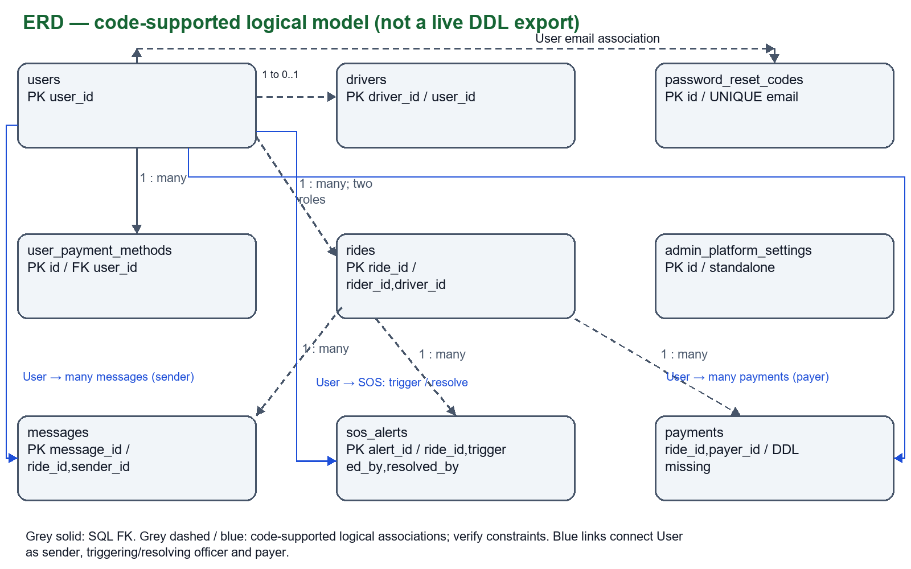
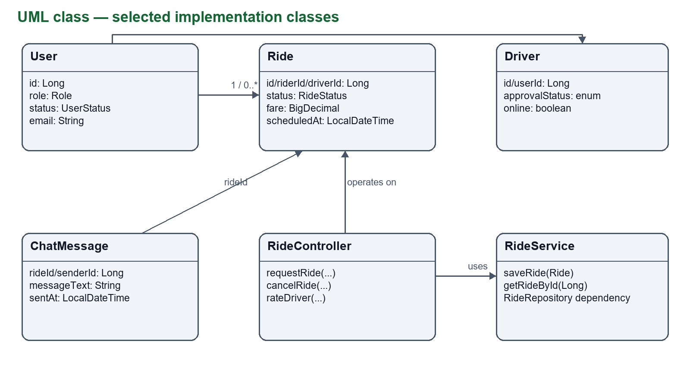
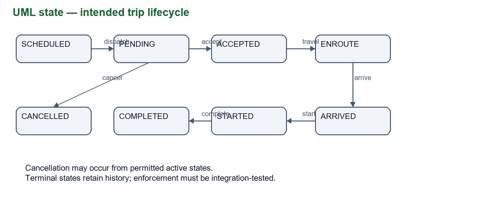
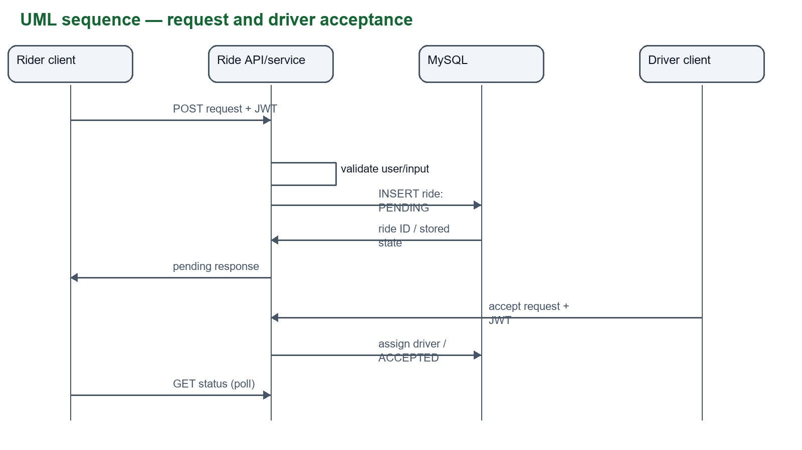
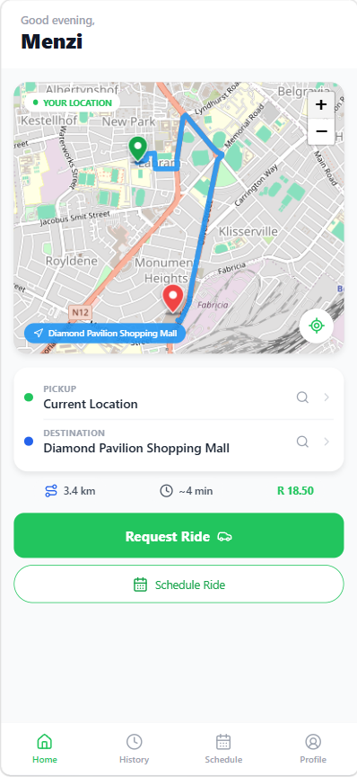
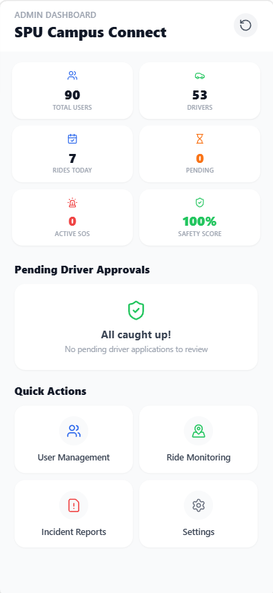
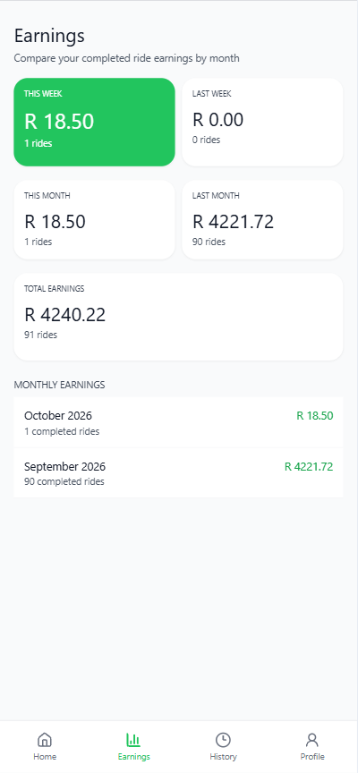

# CampusConnect — Complete Project Documentation

Prepared: 11 October 2026. Project: Campus-Ride-Connect / CampusConnect.

This document consolidates the current local implementation, existing technical guides, screen catalogue, API declarations, Java data mappings, MySQL schema and migration history, test evidence, and maintenance material. It is intended for project handover, study, review, and further development.

Evidence boundary: code presence describes implementation, not successful execution of every feature. Earlier testing results are explicitly historical. No application tests, live database inspection, database export, payment, email, or emergency dispatch were performed during this documentation build. The included database package contains source definitions, not a backup of an installed MySQL database. Credentials, account exports, tokens, identity files and private audio are excluded.

Read sections 1–12 for the project guide; use the remaining sections as detailed references. Source-relative paths refer to the inner Campus-Ride-Connect project directory.

# Contents

- 1. Project purpose, scope and current status
- 2. Roles and practical user workflows
- 3. Architecture
- 4. Requirements
- 5. Deployment
- 6. Api Spec
- 7. Security
- 8. Testing
- 9. Responsive Layout
- 10. Password Reset Email
- 11. Screen catalogue and demonstration
- 12. Database model and installation boundaries
- 13. Detailed data dictionary
- 13A. Design diagrams and captured interfaces
- 14.1 Entity: AuditLog
- 14.2 Entity: ChatMessage
- 14.3 Entity: Document
- 14.4 Entity: Driver
- 14.5 Entity: FaceVerification
- 14.6 Entity: PasswordResetCode
- 14.7 Entity: Payment
- 14.8 Entity: Rating
- 14.9 Entity: Ride
- 14.10 Entity: SafeZone
- 14.11 Entity: SosAlert
- 14.12 Entity: University
- 14.13 Entity: User
- 15. Complete controller route declaration index
- 16. Backend module inventory: controller
- 16. Backend module inventory: dto
- 16. Backend module inventory: repository
- 16. Backend module inventory: service
- 16. Backend module inventory: config
- 16. Backend module inventory: security
- 16. Backend module inventory: validation
- 16. Backend module inventory: exception
- 16. Backend module inventory: mapper
- 16. Backend module inventory: util
- 16. Backend module inventory: websocket
- 17. Contract reference: AdminController
- 17. Contract reference: AuthController
- 17. Contract reference: DocumentController
- 17. Contract reference: DriverController
- 17. Contract reference: MessageController
- 17. Contract reference: NotificationController
- 17. Contract reference: PaymentController
- 17. Contract reference: RideController
- 17. Contract reference: SecurityController
- 17. Contract reference: SosController
- 17. Contract reference: TestController
- 17. Contract reference: TripController
- 17. Contract reference: UserController
- 17. Contract reference: AuthRequest
- 17. Contract reference: AuthResponse
- 17. Contract reference: DocumentUploadRequest
- 17. Contract reference: DriverApplicationRequest
- 17. Contract reference: RatingRequest
- 17. Contract reference: RegisterRequest
- 17. Contract reference: RideRequest
- 17. Contract reference: SosAlertRequest
- 17. Contract reference: ChatMessageRepository
- 17. Contract reference: DocumentRepository
- 17. Contract reference: DriverRepository
- 17. Contract reference: FaceVerificationRepository
- 17. Contract reference: PasswordResetCodeRepository
- 17. Contract reference: PaymentRepository
- 17. Contract reference: RatingRepository
- 17. Contract reference: RideRepository
- 17. Contract reference: SafeZoneRepository
- 17. Contract reference: SosAlertRepository
- 17. Contract reference: UniversityRepository
- 17. Contract reference: UserRepository
- 18. Complete client module inventory
- 19. Client operations: services
- 19. Client operations: context
- 19. Client operations: hooks
- 20. Dependency and command reference
- 21. Sanitized configuration: application-dev.yml
- 21. Sanitized configuration: application-prod.yml
- 21. Sanitized configuration: application.yml
- 21. Container configuration: docker-compose.yml
- 21. Container configuration: Dockerfile
- 22. Test source inventory and evaluation plan
- 23. Implementation history index
- 24. Database source: 004_add_pending_driver_for_approval.sql
- 24. Database source: fix_rides_table.sql
- 24. Database source: maintenance/archive_pending_test_drivers_2026_10_05.sql
- 24. Database source: maintenance/restore_pending_test_drivers_2026_10_05.sql
- 24. Database source: migrations/001_init_schema.sql
- 24. Database source: migrations/001_update_rides_table.sql
- 24. Database source: migrations/002_add_registration_fields.sql
- 24. Database source: migrations/003_fix_face_embedding_size.sql
- 24. Database source: migrations/004_add_approved_column.sql
- 24. Database source: migrations/005_update_rides_table_add_columns.sql
- 24. Database source: migrations/006_expand_ride_statuses.sql
- 24. Database source: migrations/007_fix_ride_driver_reference.sql
- 24. Database source: migrations/008_add_rider_ratings.sql
- 24. Database source: migrations/009_add_driver_online_status.sql
- 24. Database source: migrations/010_create_messages.sql
- 24. Database source: migrations/011_add_cash_payment_method.sql
- 24. Database source: migrations/012_create_sos_alerts.sql
- 24. Database source: migrations/013_add_driver_vehicle_photo.sql
- 24. Database source: migrations/014_add_user_photos_and_rider_ratings.sql
- 24. Database source: migrations/015_persist_user_payment_methods.sql
- 24. Database source: migrations/016_add_ride_cancellation_reason.sql
- 24. Database source: migrations/017_create_password_reset_codes.sql
- 24. Database source: procedures.sql
- 24. Database source: schema.sql
- 24. Database source: seed.sql
- 24. Database source: views.sql
- 25. Database migration and maintenance catalogue
- 26. Project file inventory
- 27. Handover, unresolved work and document provenance

# 1. Project purpose, scope and current status

CampusConnect coordinates university transport and safety for riders, drivers, administrators and campus security. The interface is configured around Sol Plaatje University in Kimberley, South Africa, and uses rand-denominated fares.

Implemented application paths cover accounts and password recovery, driver onboarding and approval, immediate and scheduled ride requests, trip status and location updates, ride messages, trip history and ratings, payment display metadata and pending payment records, SOS alerts with evidence, administration and security review.

The repository is a full-stack prototype. Public hosting, physical-device validation, payment settlement, biometric matching, production security hardening, and a consolidated clean database installation remain incomplete or unverified. No participant study or operational performance measurements are supplied.


# 2. Roles and practical user workflows

| Role | Workflow |
| --- | --- |
| Rider | Register/sign in; choose pickup and destination; review estimate; request or schedule; wait for driver; follow trip; chat; report SOS if needed; complete and rate; inspect history and account/payment metadata. |
| Driver | Submit account and vehicle/application information; await approval; switch availability; inspect pending requests; accept/decline; progress enroute, arrived, started and completed stages; update location; chat; use SOS; inspect history and earnings. |
| Administrator | Sign in with privileged account; inspect statistics; review driver applications; approve/reject; manage user status; monitor rides; inspect incidents/audio; update university settings. |
| Security | Sign in with privileged account; monitor active rides; inspect SOS context and evidence; record dispatch action; inspect resolved incidents. |

The ride enum defines SCHEDULED, PENDING, ACCEPTED, ENROUTE, ARRIVED, STARTED, COMPLETED and CANCELLED. This is a logical lifecycle, not proof that all transitions are strictly enforced. RideService derives scheduled status from the requested status and scheduledAt, copies supplied journey/fare fields, persists the ride, and records start/completion timestamps when status changes. Fare integrity and concurrent acceptance require integration review.

Payment selection stores metadata; a payment API creates a PENDING record and does not charge funds. Face capture/upload does not perform biometric matching. SOS dispatch is a recorded application action; actual emergency response has not been validated.


# 3. Architecture

Source: `docs/architecture.md`

# Architecture

Client entry: mobile/index.js → mobile/App.tsx. React Native/Expo screens use
React Navigation, Axios and shared UI components. AppLayout bounds the page and
owns one rider footer; screenChrome selects native/custom headers. Platform
device APIs provide camera/location/audio/file handling. Web maps use Leaflet.

Spring Boot HTTP controllers serve /api on port 8080. Core account, driver,
ride, message, SOS and reset-code entities use Spring Data JPA. JdbcTemplate
handles settings, saved-card metadata and selected reporting/payment operations.
MySQL stores relational records. JWT filtering supplies authentication; explicit
role rules protect admin/security URL prefixes. Inspect controller ownership
checks separately; authentication alone is not authorisation.

Client polling is used for important live views; do not infer operational
WebSockets from an included dependency or empty configuration file. SMTP and
map/routing services are external dependencies. Use a reachable LAN API address
on a real device and HTTPS in a future deployment.

UML/ERD assets and relationship caveats: report/assets and report pp.6–8/13–15.
Historical SQL does not fully match JPA mappings; see deployment.md.


# 4. Requirements

Source: `docs/requirements.md`

# CampusConnect requirements

See report pp.3–5 for functional input/process/output requirements and measurable
quality targets. FR01–FR14 cover account access/recovery, selfie upload, driver
review, immediate/scheduled rides, acceptance/status, messages, ratings, payment
display records, safety alerts, account management and platform settings.

Actors: RIDER, DRIVER, ADMIN and SECURITY. A driver approval is a separate
workflow from authentication. Planned latency/uptime/usability targets are
acceptance criteria, not measured outcomes. Selfie receipt is not biometric
verification, payment preference is not settlement, and dispatch status is not
a guaranteed real-world response.

Traceability and remaining evidence: report/submission-checklist.md. The report
is prepared against the supplied NPRT630 2026 group assignment, all four phases.


# 5. Deployment

Source: `docs/deployment.md`

# Local execution and environment configuration

Project manifest: Java 25, Spring Boot 3.5.0; Expo 57, React Native 0.86,
React 19.2 and TypeScript. Install a compatible Node/npm environment and MySQL.
Do not treat this as a tested public-hosting guide.

From the repository root:

```powershell
Set-Location backend
mvn.cmd spring-boot:run
```

In a second terminal, from mobile:

```powershell
npm.cmd ci
npm.cmd run web -- --port 8083
```

If a lockfile is absent or inconsistent, resolve dependency versions deliberately
rather than silently changing them. The backend listens on 8080. ApiClient.ts
uses localhost for web/iOS simulator, 10.0.2.2 for Android emulator and an optional
LOCAL_IP for a physical phone. Phone and computer need a reachable network path.

Configure development database and JWT settings externally. Spring environment
overrides include SPRING_DATASOURCE_URL, SPRING_DATASOURCE_USERNAME,
SPRING_DATASOURCE_PASSWORD and the application JWT property overrides matching
application.yml. Configure SMTP through the documented run-with-gmail.ps1
launcher and GMAIL_USERNAME/GMAIL_APP_PASSWORD; see password-reset-email.md.
No credential values should be copied into the report or submission.

Database warning: ddl-auto:update and runtime repair exist, but schema.sql uses
rides.id/duration_minutes while the entity uses ride_id/duration_min. A payments
creation script is not evidenced. Historical migration numbers overlap and
some scripts are non-idempotent. fix_rides_table.sql rebuilds the table. Do not
execute every script blindly or against important data. Confirm a disposable
database with SHOW CREATE TABLE, consolidate migrations and test clean install.

For a production deployment, first address security.md, migrations, TLS, secrets,
backup/restore, controlled seed routines, logging and external-service policies.
Public deployment was not performed by the report preparation.


# 6. Api Spec

Source: `docs/api-spec.md`

# API inventory (source-based)

Base: http://localhost:8080/api for local development. JSON except multipart
registration/selfie/audio uploads. Protected requests use Authorization: Bearer
<token>. Refer to controller signatures for exact fields; error formats vary.
This inventory is not an OpenAPI contract or a live endpoint test.

| Area | Representative methods / paths | Source |
|---|---|---|
| Authentication | POST /auth/register; /auth/login; /auth/face/verify-direction; /auth/verification/face | AuthController |
| Recovery | POST /auth/password-reset/request; /verify; /confirm | AuthController |
| Account | GET/PUT /users/me; PUT /users/me/profile-photo | UserController |
| Saved metadata | GET/POST /users/me/payment-methods; PUT /{cardId}/default; DELETE /{cardId}; PUT /users/me/payment-method | UserController |
| Rider trips | POST /rides/request; GET /rides/active; /history; /scheduled; GET /rides/{id} | RideController |
| Trip actions | POST /rides/{id}/dispatch; /cancel; /complete; /rating; /rider-rating | RideController |
| SOS | POST /rides/{id}/sos; PUT /rides/{id}/sos/{alertId}/audio | RideController |
| Driver | GET /driver/stats; /earnings; /requests; /requests/{id}; /rides/{id}; POST /driver/online | DriverController |
| Driver actions | POST /driver/requests/{id}/accept; /decline; POST /driver/rides/{id}/status; /location | DriverController |
| Messaging | GET/POST /rides/{rideId}/messages | MessageController |
| Payment record | POST /rides/{rideId}/payment | PaymentController |
| Admin | GET /admin/dashboard/stats; /users; /rides/monitoring; /incidents; /settings | AdminController |
| Admin actions | PUT /admin/users/{id}/status; /admin/settings; POST /admin/driver-approvals/{id}/approve or reject | AdminController |
| Admin evidence | GET /admin/incidents/{id}; /admin/incidents/{id}/audio | AdminController |
| Security | GET /security/rides; /sos; POST /security/sos/{id}/dispatch; GET /security/sos/{id}/audio | SecurityController |

Saved cards contain display metadata; do not send full PAN/CVV to these APIs.
PaymentController inserts a PENDING record without a payment provider. Face
endpoints validate receipt of an image, not biometric identity or liveness.
Privileged registration and response redaction require security hardening.


# 7. Security

Source: `docs/security.md`

# Security review for documentation

Implemented mechanisms: BCrypt password hashing; JWT filtering; role checks for
/api/admin/** and /api/security/**; participant checks in selected ride/message
handlers; reset-code hashes, expiry, attempts and resend cooldown. Inspect the
code and tests rather than inferring complete protection from these mechanisms.

Observed production blockers in the current source:

- Public registration accepts ADMIN/SECURITY role values.
- Startup seed routines reset privileged account credentials.
- Returning User directly has no evidenced password-hash redaction in that entity.
- Face verification accepts uploads without biometric matching/liveness.
- Public auth/verification/test paths need a deliberate endpoint review.
- Client token storage, development HTTP/CORS, logs, uploads and audio retention
  require a deployment/privacy review; no production assurance is claimed.

Do not publish credentials, real student records, tokens or private recordings.
Use environment secrets and restrict seed routines to controlled development.
Record a negative-role/ownership test plan and assess retention/consent with the
university before processing sensitive identity/location/audio data. This is a
technical source review, not a legal compliance certification.


# 8. Testing

Source: `docs/testing.md`

# Testing evidence and commands

Fresh checks on 5 October 2026:

```powershell
# From mobile
npm.cmd run typecheck
# From backend: isolated service tests only
mvn.cmd -o "-Dtest=AuthServiceTest,PasswordResetServiceTest" test
```

TypeScript passed. Maven compiled and passed 9 tests, 0 failures/errors/skips
(AuthServiceTest: 2; PasswordResetServiceTest: 7). These tests mock repositories
and email, and do not verify SMTP delivery or database migrations.

Prior recorded session evidence on 4 October: responsive browser suite, detail
action suite and production web export passed. See responsive-layout.md for
local server/Playwright setup. Fixtures intercept API calls, so browser success
does not establish real backend integrations or participant satisfaction.

Later on 5 October, the complete backend suite passed: 23 tests, no failures or
errors. `backend/src/test/resources/application.properties` now sends integration
tests to `campus_connect_tests`, and account-creating controller tests roll back
their transactions. The pending-driver endpoint test now uses an authenticated
admin instead of expecting an anonymous request to succeed. Run `mvn.cmd test`
from `backend` with local MySQL available; never override the test datasource
with the application's `campus_connect` database.

The new multipart registration workflow tests verify that a new driver's
application appears in the admin queue and that approval/rejection updates both
the driver and user. Browser checks `mobile/scripts/check-admin-approvals.cjs`
verify automatic refresh, decisions, failure/retry and phone/tablet layouts.
`mobile/scripts/check-normal-rating.cjs` verifies a normal Home ride completion,
optional trimmed comments, rating-only submission, retry and responsive actions.
These browser scripts use synthetic intercepted API responses.

Driver SOS checks on 5 October: `DriverSosWorkflowTest` verifies that the assigned
driver's alert, GPS and reporter identity reach Security's existing queue,
Security can read synthetic evidence, and unrelated drivers cannot report or
attach evidence to the ride. All records roll back in `campus_connect_tests`;
the temporary evidence file is removed. No real alert or dispatch was sent.
`mobile/scripts/check-driver-sos.cjs` intercepts every API call and substitutes a
synthetic microphone to check placement, cancellation, sending failure/retry,
GPS/microphone denial, evidence streaming, release on return, the 60-second limit
and pending microphone permissions. Existing driver and Security page checks
also pass across seven screen sizes. Native device permissions/recording still
require physical-device validation.

Eight confirmed pending integration-test applications in the local app database
were archived on 5 October, retaining account records. The scoped archive SQL
and original-state restoration record are in `database/mysql/maintenance/`.

Manual/integration work remains: clean database installation, simultaneous
driver acceptance, ownership/role negatives, SMTP, native camera/audio/location,
keyboard/rotation, device file sharing, offline states and actual trip workflows.
Use synthetic alerts; never initiate a real emergency dispatch as a test.

Real-user study protocol and blank dataset: report/usability-study.md and
report/usability-results.csv. Do not report uncollected timings or satisfaction.


# 9. Responsive Layout

Source: `docs/responsive-layout.md`

# Responsive layouts and rider navigation

The running entry point is `mobile/index.js` → `mobile/App.tsx`. Both `App.tsx`
and the alternate `AppNavigator.tsx` use `AppLayout`.

`AppLayout` gives the navigator a bounded, shrinkable area and renders one rider
bottom bar as its sibling. Home, History, Schedule and Profile no longer render
their own bars. The bar stays mounted when changing rider tabs; it takes up its
own space, including the device's bottom safe area. Page content scrolls above
it. Rider tabs share the same header policy and do not animate the bar.

The app uses the available phone/tablet width and centers its frame up to 1200px
on larger displays. Screen roots can shrink within the viewport. Dashboard grids,
earnings cards and narrow rows wrap; map heights update on resize/rotation.
Leaflet observes its container size. History pagination and driver/security bars
reserve space rather than overlaying content. Tall dialogs and face verification
can scroll on short screens; shared bottom sheets have a tablet width limit.

## Validation

From `mobile`, run `npm.cmd run typecheck`.

The browser check uses Playwright, a local Expo server, and mocked API responses.
It never needs real credentials or modifies backend data. To install the browser
tool in an ignored directory without changing the app's dependencies:

```powershell
npm.cmd install --prefix .expo/layout-tools --no-save --package-lock=false playwright
node .expo/layout-tools/node_modules/playwright/cli.js install chromium
```

Start Expo in one terminal:

```powershell
npm.cmd run web -- --offline --port 8083
```

In another terminal, also from `mobile`:

```powershell
$env:PLAYWRIGHT_MODULE = (Resolve-Path '.expo/layout-tools/node_modules/playwright').Path
npm.cmd run check:responsive
```

Set `APP_URL` if using another local port. An existing Playwright installation
can also be supplied through `PLAYWRIGHT_MODULE`.
Pass `-- --screenshots` to save phone and tablet previews under
`mobile/.expo/responsive-checks`.

The checks cover rider navigation at 320×568, 390×844, 768×1024, 1024×768,
1280×800, 844×390 and 568×320. They verify one persistent rider bar, its bottom
position, content bounds, horizontal overflow, and scrolling without moving the
bar. Additional checks cover driver/security pages and the admin dashboard at
four sizes, user management in landscape, profile editing, password recovery,
and login/registration at the seven sizes.

These are web layout checks with fixtures. On physical Android/iOS devices,
also verify rotation, notches/home indicators, the software keyboard, camera
verification, and active ride/payment/SOS flows with your normal test accounts.

## Page chrome and action review

`screenChrome.ts` selects one header for each registered route. Pages with their
own header and primary tabs suppress the stack header; pages without a custom
back control retain the native one. `AppLayout` supplies safe-area padding where
a page does not already handle it. Registration keeps its step-back controls.
Pagination uses "Previous" to distinguish it from leaving a page. Web font
families include a system sans-serif fallback when custom fonts are unavailable.

The second mocked browser suite checks detail pages at the same seven sizes:

```powershell
npm.cmd run check:pages
```

It covers saved-card validation and deletion confirmation, rider rating,
university settings save/stay/leave, notification dismissal, user and incident
pagination, ride monitoring, authenticated audio playback and downloads,
populated security lists, missing phone/audio feedback, and driver acceptance,
chat, trip status updates and rider rating. It checks duplicate native headers
on pages with custom controls. All mutations are intercepted by fixtures.

Saved-card and settings confirmation dialogs work on web and native. Card
mutation controls are disabled while loading or saving; loading failures offer
retry. Audio downloads include authentication; players release resources when
leaving the page. Security loading failures show retry feedback. Leaflet maps
observe their containers across admin, security and driver pages as well as the
rider pages.

Camera, device phone/share/file pickers, native keyboards, actual charging,
real-time backend polling, and real SOS dispatch require physical-device and
integration checks; mocked browser checks do not validate these services.


# 10. Password Reset Email

Source: `docs/password-reset-email.md`

# Password Reset Email

Password reset codes are sent by the Spring Boot backend through Gmail SMTP. The sender is the Gmail address entered into the local launcher; the recipient is the email address entered on the Login screen. The App Password must belong to that exact sender account.

The backend reads `GMAIL_APP_PASSWORD` from its process environment. Do not put the app password in `application.yml`, source code, or a committed file. The repository `.gitignore` already excludes `.env` files.

If an App Password has been shared in chat or another public location, revoke it in Google Account security settings and generate a replacement. Stop any backend already using port 8080 before starting the configured backend.

For local development, stop the existing backend and run the launcher in a visible PowerShell terminal. From the project root use:

```powershell
.\backend\run-with-gmail.ps1
```

If the terminal is already in the `backend` folder, use:

```powershell
.\run-with-gmail.ps1
```

The launcher checks port 8080, asks for the Gmail sender address and its App Password (hidden input), removes Google's display spaces, and starts Spring Boot with those settings in its process environment.

The account must have 2-Step Verification enabled and App Passwords available. In production, configure `GMAIL_APP_PASSWORD` in the hosting platform's secret/environment settings.

The `password_reset_codes` table is defined by `database/mysql/migrations/017_create_password_reset_codes.sql`. Apply that migration to an existing database; local JPA `ddl-auto: update` also creates the entity table during development.


# 11. Screen catalogue and demonstration

# Registered screen catalogue

Every route in mobile/App.tsx is represented. Schematics are design explanations, not runtime or user-test evidence. Actual screenshots use local synthetic fixtures.

## Landing
Purpose: CampusConnect. Controls: Brand / loading / sign-in entry.
Panel evidence: SCHEMATIC. Source: mobile/App.tsx and its registered screen component.

## Login
Purpose: Welcome Back. Controls: Email / Password / Sign In / Recovery.
Panel evidence: SCHEMATIC. Source: mobile/App.tsx and its registered screen component.

## CreateAccount
Purpose: Create Account. Controls: Role / contact details / Next / step Back.
Panel evidence: SCHEMATIC. Source: mobile/App.tsx and its registered screen component.

## Legal
Purpose: Terms and Privacy. Controls: Document text / one Back control.
Panel evidence: SCHEMATIC. Source: mobile/App.tsx and its registered screen component.

## FaceVerification
Purpose: Face Verification. Controls: Permission / camera guide / capture.
Panel evidence: SCHEMATIC. Source: mobile/App.tsx and its registered screen component.

## Home
Purpose: Book a Ride. Controls: Pickup / destination / fare / request.
Panel evidence: FIXTURE CAPTURE. Source: mobile/App.tsx and its registered screen component.

## RiderHistory
Purpose: Ride History. Controls: Trips / Rate ride / Previous / Next.
Panel evidence: SCHEMATIC. Source: mobile/App.tsx and its registered screen component.

## RiderSchedule
Purpose: Schedule a Ride. Controls: Locations / date / time / planned trips.
Panel evidence: SCHEMATIC. Source: mobile/App.tsx and its registered screen component.

## RiderProfile
Purpose: My Profile. Controls: Edit / saved cards / support / logout.
Panel evidence: FIXTURE CAPTURE. Source: mobile/App.tsx and its registered screen component.

## RiderPaymentMethods
Purpose: Payment Methods. Controls: Cash / Card / Add card / owned records.
Panel evidence: SCHEMATIC. Source: mobile/App.tsx and its registered screen component.

## RatingDriver
Purpose: Rate Your Ride. Controls: Five stars / Submit rating / feedback.
Panel evidence: SCHEMATIC. Source: mobile/App.tsx and its registered screen component.

## Chat
Purpose: Ride Messages. Controls: Thread / text input / Send / Close.
Panel evidence: SCHEMATIC. Source: mobile/App.tsx and its registered screen component.

## DriverDashboard
Purpose: Driver Dashboard. Controls: Online / requests / View Request.
Panel evidence: SCHEMATIC. Source: mobile/App.tsx and its registered screen component.

## ViewRideDetails
Purpose: Ride Request Details. Controls: Rider / route / rand fare / Accept / Decline.
Panel evidence: SCHEMATIC. Source: mobile/App.tsx and its registered screen component.

## DriverActiveRide
Purpose: Active Trip. Controls: Map / contact / messages / phase button.
Panel evidence: SCHEMATIC. Source: mobile/App.tsx and its registered screen component.

## DriverEarnings
Purpose: Earnings. Controls: Month comparison / completed-trip totals.
Panel evidence: SCHEMATIC. Source: mobile/App.tsx and its registered screen component.

## DriverHistory
Purpose: Trip History. Controls: Completed trips / pagination.
Panel evidence: SCHEMATIC. Source: mobile/App.tsx and its registered screen component.

## DriverProfile
Purpose: Driver Profile. Controls: Personal and vehicle details / logout.
Panel evidence: SCHEMATIC. Source: mobile/App.tsx and its registered screen component.

## AdminDashboard
Purpose: Admin Dashboard. Controls: Stats / applications / four quick actions.
Panel evidence: SCHEMATIC. Source: mobile/App.tsx and its registered screen component.

## UserManagement
Purpose: User Management. Controls: Search / filters / suspend / pagination.
Panel evidence: SCHEMATIC. Source: mobile/App.tsx and its registered screen component.

## RideMonitoring
Purpose: Ride Monitoring. Controls: Map / current rides / Track Live / Refresh.
Panel evidence: SCHEMATIC. Source: mobile/App.tsx and its registered screen component.

## IncidentReports
Purpose: Incident Reports. Controls: Search / details / audio / pagination.
Panel evidence: SCHEMATIC. Source: mobile/App.tsx and its registered screen component.

## AudioRecordings
Purpose: Audio Recordings. Controls: Incident reference / Play / Download.
Panel evidence: SCHEMATIC. Source: mobile/App.tsx and its registered screen component.

## UniversitySettings
Purpose: University Settings. Controls: Institution / security options / Save.
Panel evidence: FIXTURE CAPTURE. Source: mobile/App.tsx and its registered screen component.

## SecurityDashboard
Purpose: Security Dashboard. Controls: Safety overview / incidents / navigation.
Panel evidence: SCHEMATIC. Source: mobile/App.tsx and its registered screen component.

## ActiveRidesMonitor
Purpose: Active Rides Monitor. Controls: Map / Center Map / Contact / rides.
Panel evidence: SCHEMATIC. Source: mobile/App.tsx and its registered screen component.

## SosAlerts
Purpose: SOS Alerts. Controls: Active alerts / Dispatch / Audio / resolved.
Panel evidence: SCHEMATIC. Source: mobile/App.tsx and its registered screen component.

## ResolvedSos
Purpose: Resolved SOS. Controls: Resolved records / search / pagination.
Panel evidence: SCHEMATIC. Source: mobile/App.tsx and its registered screen component.

## TestConnection
Purpose: Connection Test. Controls: Diagnostic request / result feedback.
Panel evidence: SCHEMATIC. Source: mobile/App.tsx and its registered screen component.


# Recorded demonstration and supervisor Q&A

Status: recording script; final video and presenter identity pending.
Use approved test accounts and a disposable database. Keep passwords, mail
credentials and student details off camera. Show actual integrated behaviour;
label any fixture-only browser segment as mocked. Never trigger a real safety
dispatch to demonstrate the feature.

| Approximate time | Demonstration | Explain |
|---|---|---|
| 0:00–0:40 | Title and group introduction | Problem, affected users, scope |
| 0:40–1:30 | Login/registration/recovery | Roles; hashing; selfie capture limitation |
| 1:30–2:40 | Rider request/schedule | Locations, rand fare, validation, pending state |
| 2:40–4:00 | Driver request/accept/message/trip phases | Participant ownership and lifecycle |
| 4:00–4:40 | History/rating/profile/cards | Metadata only; no payment settlement |
| 4:40–5:40 | Admin applications/users/settings | Confirmation, role access, dirty edits |
| 5:40–6:20 | Synthetic security incident/audio | Evidence access and dispatch-record limitation |
| 6:20–6:50 | Phone/tablet/landscape resize | One persistent rider bar; reachable dialogs |
| 6:50–7:40 | Architecture/tests/limitations | API/database split; nine unit tests; measured vs unmeasured |
| 7:40–8:10 | Reflection and improvements | Real user feedback and priorities |

Include an opening card with all names and student numbers, a clear cursor,
readable zoom and voice narration. Verify playback from another computer.
Export a common format such as MP4 and place it in the submission Demo folder.
Add the recording date/build and note whether external services were available.

Prepare answers: Why MySQL? Which relationships are enforced? How is a request
assigned safely? What is JWT? Which endpoints are public? How does password
reset expire? Why is selfie acceptance not biometric verification? What does
PENDING payment mean? Which tests mock services? What did users actually say?
Which accessibility contrast pairs fail? What would be changed before deployment?


# 12. Database model and installation boundaries

MySQL is the application store; Spring Data JPA supplies entity/repository persistence and JdbcTemplate performs selected direct SQL operations. Development configuration uses Hibernate ddl-auto:update, which can create or modify mapped tables. Some controller startup logic also creates or repairs structures. These mechanisms are not a versioned migration strategy.

Key logical relationships: users have driver profiles; rides belong to riders and may be assigned to driver users; messages belong to rides and senders; SOS records belong to rides and reporting users, with optional resolving users; saved payment methods belong to users; payment records refer to rides and payers. Some Java references are scalar IDs, so referential constraints must be verified in installed DDL.

Important drift: schema.sql declares rides.id and duration_minutes while Ride.java declares ride_id and duration_min. The entity also has scheduled/start/completion timestamps and current coordinates not fully represented by the base script. The schema driver reference targets users, while an older migration requires a correction of driver references. Historical migration prefixes overlap, including two 001 scripts. Some scripts expect a preexisting schema and are not safe to rerun. fix_rides_table.sql rebuilds rides. The Payment Java source is a stub while PaymentController inserts into payments; complete payments creation DDL is not evidenced by the existing dictionary. Empty files are listed explicitly later.

Use the dictionary and entity declarations together: SQL types reflect authored scripts; Java types and annotations reflect ORM mappings; neither establishes the installed database structure. Before installation or upgrades, inspect SHOW CREATE TABLE, choose one reconciled schema/migration baseline, use disposable data, and test migration and restore behavior. Do not run the appended SQL files as one installation script.

For a live schema reference, an operator can use SHOW TABLES; SHOW CREATE TABLE table_name; SHOW INDEX FROM table_name; and query INFORMATION_SCHEMA.KEY_COLUMN_USAGE. For a future schema-only backup use mysqldump --no-data --routines --triggers --events --user=<database-user> --password --result-file=campus_connect_schema.sql campus_connect. The password flag prompts rather than embedding a secret. This command was not executed here. Row backups require separate private storage and a verified restore procedure.


# 13. Detailed data dictionary

# Complete source-based data dictionary

This is a source inventory, not an export of the live database. JPA defaults and unverified types are labelled. See report pp.13–15 for drift and constraints.

## admin_platform_settings
| Field | Type | Size | Description | Evidence |
|---|---|---|---|---|
| id | BIGINT | - | Primary key | SQL source; live DDL not inspected |
| university_name | VARCHAR | 160 | Institution label | SQL source; live DDL not inspected |
| email_domain | VARCHAR | 120 | Configured email domain | SQL source; live DDL not inspected |
| campus_security_phone | VARCHAR | 40 | Configured phone | SQL source; live DDL not inspected |
| sos_response_time_seconds | INT | - | Configuration target | SQL source; live DDL not inspected |
| first_year_priority_matching | BOOLEAN | - | Configured preference | SQL source; live DDL not inspected |
| updated_at | DATETIME | - | Last save | SQL source; live DDL not inspected |

## drivers
| Field | Type | Size | Description | Evidence |
|---|---|---|---|---|
| driver_id | BIGINT | not specified | Primary key | JPA logical mapping; live DDL not inspected |
| user_id | BIGINT | not specified | user Id | JPA logical mapping; live DDL not inspected |
| licence_plate | VARCHAR | 255 (JPA default) | licence Plate | JPA logical mapping; live DDL not inspected |
| vehicle_make | VARCHAR | 255 (JPA default) | vehicle Make | JPA logical mapping; live DDL not inspected |
| vehicle_year | INT | not specified | vehicle Year | JPA logical mapping; live DDL not inspected |
| vehicle_photo | LONGTEXT | variable | vehicle Photo | JPA logical mapping; live DDL not inspected |
| rating | DECIMAL (precision unspecified) | not specified | rating | JPA logical mapping; live DDL not inspected |
| total_trips | INT | not specified | total Trips | JPA logical mapping; live DDL not inspected |
| online | BOOLEAN | not specified | online | JPA logical mapping; live DDL not inspected |
| approval_status | ENUM ApprovalStatus | not specified | approval Status | JPA logical mapping; live DDL not inspected |

## messages
| Field | Type | Size | Description | Evidence |
|---|---|---|---|---|
| message_id | BIGINT | not specified | Primary key | JPA logical mapping; live DDL not inspected |
| ride_id | BIGINT | not specified | ride Id | JPA logical mapping; live DDL not inspected |
| sender_id | BIGINT | not specified | sender Id | JPA logical mapping; live DDL not inspected |
| message_text | VARCHAR | 1000 | message Text | JPA logical mapping; live DDL not inspected |
| sent_at | DATETIME | not specified | sent At | JPA logical mapping; live DDL not inspected |

## password_reset_codes
| Field | Type | Size | Description | Evidence |
|---|---|---|---|---|
| id | BIGINT | not specified | Primary key | JPA logical mapping; live DDL not inspected |
| email | VARCHAR | 255 | email | JPA logical mapping; live DDL not inspected |
| code_hash | VARCHAR | 255 | code Hash | JPA logical mapping; live DDL not inspected |
| expires_at | DATETIME | not specified | expires At | JPA logical mapping; live DDL not inspected |
| created_at | DATETIME | not specified | created At | JPA logical mapping; live DDL not inspected |
| attempts | INT | not specified | attempts | JPA logical mapping; live DDL not inspected |

## payments
| Field | Type | Size | Description | Evidence |
|---|---|---|---|---|
| ride_id | ID type unverified | UNVERIFIED | Trip | Insert contract only; creation DDL missing |
| payer_id | ID type unverified | UNVERIFIED | Payer | Insert contract only; creation DDL missing |
| amount | Numeric type unverified | UNVERIFIED | Fare record | Insert contract only; creation DDL missing |
| method | ENUM/string unverified | UNVERIFIED | CASH/CARD; expanded enum migration | Insert contract only; creation DDL missing |
| status | String/enum unverified | UNVERIFIED | PENDING inserted | Insert contract only; creation DDL missing |
| transaction_ref | String unverified | UNVERIFIED | Reference; no settlement | Insert contract only; creation DDL missing |

## rides
| Field | Type | Size | Description | Evidence |
|---|---|---|---|---|
| ride_id | BIGINT | not specified | Primary key | JPA logical mapping; live DDL not inspected |
| rider_id | BIGINT | not specified | rider Id | JPA logical mapping; live DDL not inspected |
| driver_id | BIGINT | not specified | driver Id | JPA logical mapping; live DDL not inspected |
| pickup_location | VARCHAR | 255 (JPA default) | pickup Location | JPA logical mapping; live DDL not inspected |
| destination | VARCHAR | 255 (JPA default) | destination | JPA logical mapping; live DDL not inspected |
| pickup_lat | DOUBLE | not specified | pickup Lat | JPA logical mapping; live DDL not inspected |
| pickup_lng | DOUBLE | not specified | pickup Lng | JPA logical mapping; live DDL not inspected |
| dest_lat | DOUBLE | not specified | dest Lat | JPA logical mapping; live DDL not inspected |
| dest_lng | DOUBLE | not specified | dest Lng | JPA logical mapping; live DDL not inspected |
| current_lat | DOUBLE | not specified | current Lat | JPA logical mapping; live DDL not inspected |
| current_lng | DOUBLE | not specified | current Lng | JPA logical mapping; live DDL not inspected |
| fare | DECIMAL (precision unspecified) | not specified | fare | JPA logical mapping; live DDL not inspected |
| distance_km | DOUBLE | not specified | distance Km | JPA logical mapping; live DDL not inspected |
| duration_min | DOUBLE | not specified | duration Minutes | JPA logical mapping; live DDL not inspected |
| status | ENUM RideStatus | not specified | status | JPA logical mapping; live DDL not inspected |
| scheduled_at | DATETIME | not specified | scheduled At | JPA logical mapping; live DDL not inspected |
| started_at | DATETIME | not specified | started At | JPA logical mapping; live DDL not inspected |
| completed_at | DATETIME | not specified | completed At | JPA logical mapping; live DDL not inspected |
| cancellation_reason | VARCHAR | 500 | cancellation Reason | JPA logical mapping; live DDL not inspected |
| cancelled_by | BIGINT | not specified | cancelled By | JPA logical mapping; live DDL not inspected |
| rider_rating | INT | not specified | rider Rating | JPA logical mapping; live DDL not inspected |
| rider_rating_comment | VARCHAR | 500 | rider Rating Comment | JPA logical mapping; live DDL not inspected |
| driver_rating | INT | not specified | driver Rating | JPA logical mapping; live DDL not inspected |
| driver_rating_comment | VARCHAR | 500 | driver Rating Comment | JPA logical mapping; live DDL not inspected |
| created_at | DATETIME | not specified | created At | JPA logical mapping; live DDL not inspected |

## sos_alerts
| Field | Type | Size | Description | Evidence |
|---|---|---|---|---|
| alert_id | BIGINT | not specified | Primary key | JPA logical mapping; live DDL not inspected |
| ride_id | BIGINT | not specified | ride Id | JPA logical mapping; live DDL not inspected |
| triggered_by | BIGINT | not specified | triggered By | JPA logical mapping; live DDL not inspected |
| gps_lat | DOUBLE | not specified | gps Lat | JPA logical mapping; live DDL not inspected |
| gps_lng | DOUBLE | not specified | gps Lng | JPA logical mapping; live DDL not inspected |
| audio_file_path | VARCHAR | 500 | audio File Path | JPA logical mapping; live DDL not inspected |
| recording_duration | INT | not specified | recording Duration | JPA logical mapping; live DDL not inspected |
| status | VARCHAR | 30 | status | JPA logical mapping; live DDL not inspected |
| created_at | DATETIME | not specified | created At | JPA logical mapping; live DDL not inspected |
| resolved_at | DATETIME | - | Resolution time | SQL source; live DDL not inspected |
| resolved_by | BIGINT | - | Resolving user ID | SQL source; live DDL not inspected |

## user_payment_methods
| Field | Type | Size | Description | Evidence |
|---|---|---|---|---|
| id | BIGINT | - | Primary key | SQL source; live DDL not inspected |
| user_id | BIGINT | - | Owning user | SQL source; live DDL not inspected |
| label | VARCHAR | 80 | Display label | SQL source; live DDL not inspected |
| last_four | CHAR | 4 | Last four digits | SQL source; live DDL not inspected |
| brand | VARCHAR | 32 | Card brand | SQL source; live DDL not inspected |
| expiry | CHAR | 5 | MM/YY expiry | SQL source; live DDL not inspected |
| cardholder | VARCHAR | 120 | Display name | SQL source; live DDL not inspected |
| is_default | BOOLEAN | - | Default flag | SQL source; live DDL not inspected |
| created_at | DATETIME | - | Creation time | SQL source; live DDL not inspected |

## users
| Field | Type | Size | Description | Evidence |
|---|---|---|---|---|
| user_id | BIGINT | not specified | Primary key | JPA logical mapping; live DDL not inspected |
| full_name | VARCHAR | 255 (JPA default) | full Name | JPA logical mapping; live DDL not inspected |
| email | VARCHAR | 255 (JPA default) | email | JPA logical mapping; live DDL not inspected |
| password_hash | VARCHAR | 255 (JPA default) | password Hash | JPA logical mapping; live DDL not inspected |
| role | ENUM Role | not specified | role | JPA logical mapping; live DDL not inspected |
| year_of_study | INT | not specified | year Of Study | JPA logical mapping; live DDL not inspected |
| emergency_contact | VARCHAR | 255 (JPA default) | emergency Contact | JPA logical mapping; live DDL not inspected |
| student_number | VARCHAR | 255 (JPA default) | student Number | JPA logical mapping; live DDL not inspected |
| phone | VARCHAR | 255 (JPA default) | phone | JPA logical mapping; live DDL not inspected |
| profile_photo | LONGTEXT | variable | profile Photo | JPA logical mapping; live DDL not inspected |
| licence_plate | VARCHAR | 255 (JPA default) | licence Plate | JPA logical mapping; live DDL not inspected |
| vehicle_make | VARCHAR | 255 (JPA default) | vehicle Make | JPA logical mapping; live DDL not inspected |
| vehicle_year | INT | not specified | vehicle Year | JPA logical mapping; live DDL not inspected |
| face_verified | BOOLEAN | not specified | face Verified | JPA logical mapping; live DDL not inspected |
| face_embedding | TEXT | variable | face Embedding | JPA logical mapping; live DDL not inspected |
| status | ENUM UserStatus | not specified | status | JPA logical mapping; live DDL not inspected |
| created_at | DATETIME | not specified | created At | JPA logical mapping; live DDL not inspected |
| default_payment_method | VARCHAR | 20 | Default payment preference | SQL source; live DDL not inspected |


# 13A. Design diagrams and captured interfaces

The following are existing project report diagrams and supplied interface captures. They illustrate the documented design and captured states, rather than a newly verified installed database or current running session.
















# 14.1 Entity: AuditLog

Source: `backend/src/main/java/com/campusconnect/entity/AuditLog.java`. Java types and annotations are logical mappings; actual MySQL DDL has not been inspected.

No declared persistent fields found. This file may be an unimplemented placeholder.

```java

```


# 14.2 Entity: ChatMessage

Source: `backend/src/main/java/com/campusconnect/entity/ChatMessage.java`. Java types and annotations are logical mappings; actual MySQL DDL has not been inspected.

| Field | Java type | Mapping / constraints |
| --- | --- | --- |
| id | Long | @Id @GeneratedValue(strategy = GenerationType.IDENTITY) @Column(name = "message_id") |
| rideId | Long | @Column(name = "ride_id", nullable = false) |
| senderId | Long | @Column(name = "sender_id", nullable = false) |
| messageText | String | @Column(name = "message_text", nullable = false, length = 1000) |
| sentAt | LocalDateTime | @Column(name = "sent_at", nullable = false) |


# 14.3 Entity: Document

Source: `backend/src/main/java/com/campusconnect/entity/Document.java`. Java types and annotations are logical mappings; actual MySQL DDL has not been inspected.

No declared persistent fields found. This file may be an unimplemented placeholder.

```java

```


# 14.4 Entity: Driver

Source: `backend/src/main/java/com/campusconnect/entity/Driver.java`. Java types and annotations are logical mappings; actual MySQL DDL has not been inspected.

| Field | Java type | Mapping / constraints |
| --- | --- | --- |
| id | Long | @Id @GeneratedValue(strategy = GenerationType.IDENTITY) @Column(name = "driver_id") |
| userId | Long | @Column(name = "user_id", nullable = false) |
| licencePlate | String | @Column(name = "licence_plate") |
| vehicleMake | String | @Column(name = "vehicle_make") |
| vehicleYear | Integer | @Column(name = "vehicle_year") |
| vehiclePhoto | String | @Column(name = "vehicle_photo", columnDefinition = "LONGTEXT") |
| rating | BigDecimal | No explicit field annotation |
| totalTrips | Integer | @Column(name = "total_trips") |
| online | boolean | @Column(name = "online", nullable = false) |
| approvalStatus | ApprovalStatus | @Enumerated(EnumType.STRING) @Column(name = "approval_status") |

Enum ApprovalStatus: PENDING, APPROVED, REJECTED


# 14.5 Entity: FaceVerification

Source: `backend/src/main/java/com/campusconnect/entity/FaceVerification.java`. Java types and annotations are logical mappings; actual MySQL DDL has not been inspected.

No declared persistent fields found. This file may be an unimplemented placeholder.

```java

```


# 14.6 Entity: PasswordResetCode

Source: `backend/src/main/java/com/campusconnect/entity/PasswordResetCode.java`. Java types and annotations are logical mappings; actual MySQL DDL has not been inspected.

| Field | Java type | Mapping / constraints |
| --- | --- | --- |
| id | Long | @Id @GeneratedValue(strategy = GenerationType.IDENTITY) |
| email | String | @Column(nullable = false, unique = true, length = 255) |
| codeHash | String | @Column(name = "code_hash", nullable = false, length = 255) |
| expiresAt | LocalDateTime | @Column(name = "expires_at", nullable = false) |
| createdAt | LocalDateTime | @Column(name = "created_at", nullable = false) |
| attempts | int | @Column(nullable = false) |


# 14.7 Entity: Payment

Source: `backend/src/main/java/com/campusconnect/entity/Payment.java`. Java types and annotations are logical mappings; actual MySQL DDL has not been inspected.

No declared persistent fields found. This file may be an unimplemented placeholder.

```java

```


# 14.8 Entity: Rating

Source: `backend/src/main/java/com/campusconnect/entity/Rating.java`. Java types and annotations are logical mappings; actual MySQL DDL has not been inspected.

No declared persistent fields found. This file may be an unimplemented placeholder.

```java

```


# 14.9 Entity: Ride

Source: `backend/src/main/java/com/campusconnect/entity/Ride.java`. Java types and annotations are logical mappings; actual MySQL DDL has not been inspected.

| Field | Java type | Mapping / constraints |
| --- | --- | --- |
| id | Long | @Id @GeneratedValue(strategy = GenerationType.IDENTITY) @Column(name = "ride_id") |
| riderId | Long | @Column(name = "rider_id", nullable = false) |
| driverId | Long | @Column(name = "driver_id") |
| pickupLocation | String | @Column(name = "pickup_location") |
| destination | String | @Column(name = "destination") |
| pickupLat | Double | @Column(name = "pickup_lat") |
| pickupLng | Double | @Column(name = "pickup_lng") |
| destLat | Double | @Column(name = "dest_lat") |
| destLng | Double | @Column(name = "dest_lng") |
| currentLat | Double | @Column(name = "current_lat") |
| currentLng | Double | @Column(name = "current_lng") |
| fare | BigDecimal | @Column(name = "fare") |
| distanceKm | Double | @Column(name = "distance_km") |
| durationMinutes | Double | @Column(name = "duration_min") |
| status | RideStatus | @Enumerated(EnumType.STRING) @Column(name = "status") |
| scheduledAt | LocalDateTime | @Column(name = "scheduled_at") |
| startedAt | LocalDateTime | @Column(name = "started_at") |
| completedAt | LocalDateTime | @Column(name = "completed_at") |
| cancellationReason | String | @Column(name = "cancellation_reason", length = 500) |
| cancelledBy | Long | @Column(name = "cancelled_by") |
| riderRating | Integer | @Column(name = "rider_rating") |
| riderRatingComment | String | @Column(name = "rider_rating_comment", length = 500) |
| driverRating | Integer | @Column(name = "driver_rating") |
| driverRatingComment | String | @Column(name = "driver_rating_comment", length = 500) |
| createdAt | LocalDateTime | @Column(name = "created_at") |

Enum RideStatus: SCHEDULED, PENDING, ACCEPTED, ENROUTE, ARRIVED, STARTED, COMPLETED, CANCELLED


# 14.10 Entity: SafeZone

Source: `backend/src/main/java/com/campusconnect/entity/SafeZone.java`. Java types and annotations are logical mappings; actual MySQL DDL has not been inspected.

No declared persistent fields found. This file may be an unimplemented placeholder.

```java

```


# 14.11 Entity: SosAlert

Source: `backend/src/main/java/com/campusconnect/entity/SosAlert.java`. Java types and annotations are logical mappings; actual MySQL DDL has not been inspected.

| Field | Java type | Mapping / constraints |
| --- | --- | --- |
| id | Long | @Id @GeneratedValue(strategy = GenerationType.IDENTITY) @Column(name = "alert_id") |
| rideId | Long | @Column(name = "ride_id", nullable = false) |
| triggeredBy | Long | @Column(name = "triggered_by", nullable = false) |
| gpsLat | Double | @Column(name = "gps_lat") |
| gpsLng | Double | @Column(name = "gps_lng") |
| audioFilePath | String | @Column(name = "audio_file_path", length = 500) |
| recordingDuration | Integer | @Column(name = "recording_duration") |
| status | String | @Column(name = "status", nullable = false, length = 30) |
| createdAt | LocalDateTime | @Column(name = "created_at", nullable = false) |


# 14.12 Entity: University

Source: `backend/src/main/java/com/campusconnect/entity/University.java`. Java types and annotations are logical mappings; actual MySQL DDL has not been inspected.

No declared persistent fields found. This file may be an unimplemented placeholder.

```java

```


# 14.13 Entity: User

Source: `backend/src/main/java/com/campusconnect/entity/User.java`. Java types and annotations are logical mappings; actual MySQL DDL has not been inspected.

| Field | Java type | Mapping / constraints |
| --- | --- | --- |
| id | Long | @Id @GeneratedValue(strategy = GenerationType.IDENTITY) @Column(name = "user_id") |
| fullName | String | @Column(name = "full_name") |
| email | String | @Column(unique = true, nullable = false) |
| passwordHash | String | @Column(name = "password_hash", nullable = false) |
| role | Role | @Enumerated(EnumType.STRING) @Column(name = "role", nullable = false) |
| yearOfStudy | Integer | @Column(name = "year_of_study") |
| emergencyContact | String | @Column(name = "emergency_contact") |
| studentNumber | String | @Column(name = "student_number") |
| phone | String | @Column(name = "phone") |
| profilePhoto | String | @Column(name = "profile_photo", columnDefinition = "LONGTEXT") |
| licencePlate | String | @Column(name = "licence_plate") |
| vehicleMake | String | @Column(name = "vehicle_make") |
| vehicleYear | Integer | @Column(name = "vehicle_year") |
| faceVerified | Boolean | @Column(name = "face_verified") |
| faceEmbedding | String | @Column(name = "face_embedding", columnDefinition = "TEXT") |
| status | UserStatus | @Enumerated(EnumType.STRING) @Column(name = "status") |
| createdAt | LocalDateTime | @Column(name = "created_at") |

Enum Role: RIDER, DRIVER, ADMIN, SECURITY

Enum UserStatus: ACTIVE, PENDING, SUSPENDED


# 15. Complete controller route declaration index

Extracted from current Java annotations. RequestMapping entries marked REQUEST* may require additional method/path inspection. This index does not infer role enforcement, request schemas, alternate mapping arrays or successful live responses. The detailed controller contract appendix below supplies the declaration context.

| HTTP | Declared path | Controller | Handler |
| --- | --- | --- | --- |
| GET | /api/admin/stats | AdminController | getStats |
| GET | /api/admin/dashboard | AdminController | getDashboard |
| GET | /api/admin/dashboard/stats | AdminController | getDashboardStatsLegacy |
| GET | /api/admin/users | AdminController | getUsers |
| PUT | /api/admin/users/{id}/status | AdminController | updateUserStatus |
| GET | /api/admin/rides/monitoring | AdminController | getRideMonitoring |
| GET | /api/admin/incidents | AdminController | getIncidents |
| GET | /api/admin/settings | AdminController | getSettings |
| PUT | /api/admin/settings | AdminController | updateSettings |
| GET | /api/admin/incidents/{id} | AdminController | getIncident |
| GET | /api/admin/incidents/{id}/audio | AdminController | getIncidentAudio |
| GET | /api/admin/driver-approvals | AdminController | RequestParam |
| GET | /api/admin/driver-approvals/pending | AdminController | getPendingDriverApprovalsLegacy |
| POST | /api/admin/driver-approvals/{id}/approve | AdminController | PathVariable |
| POST | /api/admin/driver-approvals/{id}/reject | AdminController | PathVariable |
| POST | /api/auth/register | AuthController | register |
| POST | /api/auth/register | AuthController | RequestParam |
| POST | /api/auth/face/verify-direction | AuthController | RequestParam |
| POST | /api/auth/verification/face | AuthController | RequestParam |
| POST | /api/auth/login | AuthController | login |
| POST | /api/auth/password-reset/request | AuthController | requestPasswordReset |
| POST | /api/auth/password-reset/verify | AuthController | verifyPasswordResetCode |
| POST | /api/auth/password-reset/confirm | AuthController | confirmPasswordReset |
| GET | /api/driver/stats | DriverController | getDriverStats |
| GET | /api/driver/earnings | DriverController | getDriverEarnings |
| GET | /api/driver/history | DriverController | getDriverHistory |
| GET | /api/driver/profile | DriverController | getDriverProfile |
| GET | /api/driver/requests | DriverController | getDriverRequests |
| GET | /api/driver/requests/{id} | DriverController | PathVariable |
| GET | /api/driver/rides/{id} | DriverController | PathVariable |
| POST | /api/driver/rides/{id}/status | DriverController | PathVariable |
| POST | /api/driver/rides/{id}/location | DriverController | PathVariable |
| POST | /api/driver/online | DriverController | setOnlineStatus |
| POST | /api/driver/requests/{id}/accept | DriverController | PathVariable |
| POST | /api/driver/requests/{id}/decline | DriverController | PathVariable |
| GET | /api/rides/{rideId}/messages | MessageController | getMessages |
| POST | /api/rides/{rideId}/messages | MessageController | sendMessage |
| POST | /api/rides/{rideId}/payment | PaymentController | createPayment |
| POST | /api/rides/request | RideController | requestRide |
| POST | /api/rides | RideController | createRide |
| GET | /api/rides/active | RideController | getActiveRide |
| GET | /api/rides/{id} | RideController | getRideById |
| GET | /api/rides/{id}/status | RideController | getRideStatus |
| GET | /api/rides/history | RideController | getHistory |
| GET | /api/rides/scheduled | RideController | getScheduledRides |
| POST | /api/rides/{id}/dispatch | RideController | dispatchRide |
| POST | /api/rides/{id}/cancel | RideController | RequestBody |
| POST | /api/rides/{id}/complete | RideController | completeRide |
| POST | /api/rides/{id}/rating | RideController | rateDriver |
| POST | /api/rides/{id}/rider-rating | RideController | rateRider |
| POST | /api/rides/{id}/sos | RideController | RequestBody |
| PUT | /api/rides/{id}/sos/{alertId}/audio | RideController | RequestParam |
| GET | /api/security/dashboard | SecurityController | dashboard |
| GET | /api/security/rides | SecurityController | rides |
| GET | /api/security/sos | SecurityController | sos |
| POST | /api/security/sos/{id}/dispatch | SecurityController | dispatch |
| GET | /api/security/sos/{id}/audio | SecurityController | audio |
| GET | /api/test/connection | TestController | testConnection |
| GET | /api/test/hello | TestController | hello |
| GET | /api/users | UserController | getAllUsers |
| GET | /api/users/{id}/status | UserController | getUserStatus |
| GET | /api/users/me | UserController | getCurrentUser |
| PUT | /api/users/me | UserController | updateCurrentUser |
| PUT | /api/users/me/profile-photo | UserController | updateProfilePhoto |
| GET | /api/users/me/payment-methods | UserController | getPaymentMethods |
| POST | /api/users/me/payment-methods | UserController | addPaymentMethod |
| PUT | /api/users/me/payment-methods/{cardId}/default | UserController | setDefaultCard |
| DELETE | /api/users/me/payment-methods/{cardId} | UserController | deletePaymentMethod |
| PUT | /api/users/me/payment-method | UserController | updateDefaultPaymentMethod |


# 16. Backend module inventory: controller

| Module | Declared operations | Project dependencies |
| --- | --- | --- |
| AdminController | getStats, getDashboard, getDashboardStatsLegacy, getUsers, updateUserStatus, getRideMonitoring, getIncidents, getSettings, updateSettings, getIncident, getIncidentAudio, getPendingDriverApprovals, getPendingDriverApprovalsLegacy, approveDriver, rejectDriver | entity.Driver, entity.User, repository.DriverRepository, repository.RideRepository, repository.UserRepository |
| AuthController | register, registerMultipart, verifyFaceDirection, verifyFace, login, requestPasswordReset, verifyPasswordResetCode, confirmPasswordReset | dto.AuthRequest, dto.AuthResponse, dto.RegisterRequest, entity.User, repository.UserRepository, service.AuthService, service.PasswordResetService |
| DocumentController | No public/protected method declarations | No project imports |
| DriverController | getDriverStats, getDriverEarnings, getDriverHistory, getDriverProfile, getDriverRequests, getRideRequestDetails, getAssignedRide, updateAssignedRideStatus, updateAssignedRideLocation, setOnlineStatus, acceptRequest, declineRequest | entity.Driver, entity.Ride, entity.User, repository.DriverRepository, repository.RideRepository, repository.UserRepository |
| MessageController | getMessages, sendMessage | entity.ChatMessage, entity.Ride, repository.ChatMessageRepository, repository.RideRepository, repository.UserRepository |
| NotificationController | No public/protected method declarations | No project imports |
| PaymentController | createPayment | entity.Ride, repository.RideRepository |
| RideController | requestRide, createRide, getActiveRide, getRideById, getRideStatus, getHistory, getScheduledRides, dispatchRide, cancelRide, completeRide, rateDriver, rateRider, sosAlert, uploadSosAudio | dto.RideRequest, entity.Ride, entity.SosAlert, repository.DriverRepository, repository.SosAlertRepository, repository.UserRepository, service.RideService |
| SecurityController | dashboard, rides, sos, dispatch, audio | No project imports |
| SosController | No public/protected method declarations | No project imports |
| TestController | testConnection, hello | No project imports |
| TripController | No public/protected method declarations | No project imports |
| UserController | getAllUsers, getUserStatus, getCurrentUser, updateCurrentUser, updateProfilePhoto, getPaymentMethods, addPaymentMethod, setDefaultCard, deletePaymentMethod, updateDefaultPaymentMethod | entity.Driver, entity.User, repository.DriverRepository, repository.UserRepository |


# 16. Backend module inventory: dto

| Module | Declared operations | Project dependencies |
| --- | --- | --- |
| AuthRequest | getEmail, setEmail, getPassword, setPassword | No project imports |
| AuthResponse | getToken, setToken, getUser, setUser | entity.User |
| DocumentUploadRequest | No public/protected method declarations | No project imports |
| DriverApplicationRequest | No public/protected method declarations | No project imports |
| RatingRequest | No public/protected method declarations | No project imports |
| RegisterRequest | getFullName, setFullName, getEmail, setEmail, getPassword, setPassword, getRole, setRole, getYearOfStudy, setYearOfStudy, getEmergencyContact, setEmergencyContact, getStudentNumber, setStudentNumber, getPhone, setPhone, getLicencePlate, setLicencePlate, getVehicleMake, setVehicleMake, getVehicleYear, setVehicleYear, getVehiclePhoto, setVehiclePhoto, getFaceVerified, setFaceVerified, getFaceEmbedding, setFaceEmbedding | No project imports |
| RideRequest | getPickupLocation, setPickupLocation, getPickupAddress, setPickupAddress, getPickupLat, setPickupLat, getPickupLng, setPickupLng, getDestination, setDestination, getDestinationAddress, setDestinationAddress, getDestLat, setDestLat, getDestLng, setDestLng, getDistanceKm, setDistanceKm, getDuration, setDuration, getFare, setFare, getStatus, setStatus, getScheduledAt, setScheduledAt | No project imports |
| SosAlertRequest | No public/protected method declarations | No project imports |


# 16. Backend module inventory: repository

| Module | Declared operations | Project dependencies |
| --- | --- | --- |
| ChatMessageRepository | No public/protected method declarations | entity.ChatMessage |
| DocumentRepository | No public/protected method declarations | No project imports |
| DriverRepository | No public/protected method declarations | entity.Driver |
| FaceVerificationRepository | No public/protected method declarations | No project imports |
| PasswordResetCodeRepository | No public/protected method declarations | entity.PasswordResetCode |
| PaymentRepository | No public/protected method declarations | No project imports |
| RatingRepository | No public/protected method declarations | No project imports |
| RideRepository | No public/protected method declarations | entity.Ride |
| SafeZoneRepository | No public/protected method declarations | No project imports |
| SosAlertRepository | No public/protected method declarations | entity.SosAlert |
| UniversityRepository | No public/protected method declarations | No project imports |
| UserRepository | No public/protected method declarations | entity.User |


# 16. Backend module inventory: service

| Module | Declared operations | Project dependencies |
| --- | --- | --- |
| AdminService | No public/protected method declarations | No project imports |
| AudioService | No public/protected method declarations | No project imports |
| AuthService | register, login | dto.AuthRequest, dto.AuthResponse, dto.RegisterRequest, entity.Driver, entity.User, repository.DriverRepository, repository.UserRepository, security.JwtTokenProvider |
| DriverService | No public/protected method declarations | No project imports |
| FaceRecognitionService | No public/protected method declarations | No project imports |
| NotificationService | No public/protected method declarations | No project imports |
| PasswordResetService | requestCode, verifyCode, resetPassword | entity.PasswordResetCode, entity.User, repository.PasswordResetCodeRepository, repository.UserRepository |
| PaymentService | No public/protected method declarations | No project imports |
| RatingService | No public/protected method declarations | No project imports |
| RideService | requestRide, getHistory, getScheduledRidesForRider, getPendingRides, getRideById, saveRide, getActiveRideForRider, acceptRide, updateRideStatus, cancelRide | dto.RideRequest, entity.Ride, repository.RideRepository |
| SecurityService | No public/protected method declarations | No project imports |
| SosService | No public/protected method declarations | No project imports |
| TripHistoryService | No public/protected method declarations | No project imports |
| UniversityService | No public/protected method declarations | No project imports |
| UserService | No public/protected method declarations | No project imports |
| VerificationService | No public/protected method declarations | No project imports |


# 16. Backend module inventory: config

| Module | Declared operations | Project dependencies |
| --- | --- | --- |
| AppConfig | No public/protected method declarations | No project imports |
| JwtAuthenticationFilter | doFilterInternal | security.JwtTokenProvider |
| SecurityConfig | passwordEncoder, filterChain, corsConfigurationSource | No project imports |
| WebSocketConfig | No public/protected method declarations | No project imports |


# 16. Backend module inventory: security

| Module | Declared operations | Project dependencies |
| --- | --- | --- |
| CustomUserDetailsService | No public/protected method declarations | No project imports |
| JwtAuthenticationEntryPoint | No public/protected method declarations | No project imports |
| JwtTokenProvider | init, generateToken, validateToken, getUserIdFromToken, getRoleFromToken | entity.User |
| Role | No public/protected method declarations | No project imports |
| UserPrincipal | No public/protected method declarations | No project imports |


# 16. Backend module inventory: validation

| Module | Declared operations | Project dependencies |
| --- | --- | --- |
| ValidEmail | No public/protected method declarations | No project imports |
| ValidEmailValidator | No public/protected method declarations | No project imports |


# 16. Backend module inventory: exception

| Module | Declared operations | Project dependencies |
| --- | --- | --- |
| ApiException | No public/protected method declarations | No project imports |
| GlobalExceptionHandler | No public/protected method declarations | No project imports |
| ResourceNotFoundException | No public/protected method declarations | No project imports |


# 16. Backend module inventory: mapper

| Module | Declared operations | Project dependencies |
| --- | --- | --- |
| DriverMapper | No public/protected method declarations | No project imports |
| RideMapper | No public/protected method declarations | No project imports |
| UserMapper | No public/protected method declarations | No project imports |


# 16. Backend module inventory: util

| Module | Declared operations | Project dependencies |
| --- | --- | --- |
| DateTimeUtil | No public/protected method declarations | No project imports |
| EncryptionUtil | No public/protected method declarations | No project imports |
| FileStorageUtil | No public/protected method declarations | No project imports |
| GeoUtil | No public/protected method declarations | No project imports |
| OcrUtil | No public/protected method declarations | No project imports |


# 16. Backend module inventory: websocket

| Module | Declared operations | Project dependencies |
| --- | --- | --- |
| SocketIoGateway | No public/protected method declarations | No project imports |


# 17. Contract reference: AdminController

Source: `backend/src/main/java/com/campusconnect/controller/AdminController.java`

```java
@RequestMapping("/api/admin")
@CrossOrigin(origins = "*")
public class AdminController

@GetMapping("/stats")
    public ResponseEntity<Map<String, Object>> getStats()

@GetMapping("/dashboard")
    public ResponseEntity<Map<String, Object>> getDashboard()

@GetMapping("/dashboard/stats")
    public ResponseEntity<Map<String, Object>> getDashboardStatsLegacy()

@GetMapping("/users")
    public ResponseEntity<List<Map<String, Object>>> getUsers()

@PutMapping("/users/

@GetMapping("/rides/monitoring")
    public ResponseEntity<List<Map<String, Object>>> getRideMonitoring()

@GetMapping("/incidents")
    public ResponseEntity<List<Map<String, Object>>> getIncidents()

@GetMapping("/settings")
    public ResponseEntity<Map<String, Object>> getSettings()

@PutMapping("/settings")
    public ResponseEntity<?> updateSettings(@RequestBody Map<String, Object> request)

@GetMapping("/incidents/

@GetMapping("/incidents/

@GetMapping("/driver-approvals")
    public ResponseEntity<List<Map<String, Object>>> getPendingDriverApprovals(
            @RequestParam(value = "status", required = false, defaultValue = "PENDING") String status
    )

@GetMapping("/driver-approvals/pending")
    public ResponseEntity<List<Map<String, Object>>> getPendingDriverApprovalsLegacy()

@PostMapping("/driver-approvals/

@PostMapping("/driver-approvals/
```


# 17. Contract reference: AuthController

Source: `backend/src/main/java/com/campusconnect/controller/AuthController.java`

```java
@RequestMapping("/api/auth")
@CrossOrigin(origins = "*")
public class AuthController

@PostMapping(value = "/register", consumes = MediaType.APPLICATION_JSON_VALUE)
    public ResponseEntity<?> register(@RequestBody RegisterRequest request)

@PostMapping(value = "/register", consumes = MediaType.MULTIPART_FORM_DATA_VALUE)
    public ResponseEntity<?> registerMultipart(
            @RequestParam("fullName") String fullName,
            @RequestParam("email") String email,
            @RequestParam("password") String password,
            @RequestParam("role") String role,
            @RequestParam(value = "yearOfStudy", required = false) Integer yearOfStudy,
            @RequestParam(value = "emergencyContact", required = false) String emergencyContact,
            @RequestParam(value = "studentNumber", required = false) String studentNumber,
            @RequestParam(value = "phone", required = false) String phone,
            @RequestParam(value = "licencePlate", required = false) String licencePlate,
            @RequestParam(value = "vehicleMake", required = false) String vehicleMake,
            @RequestParam(value = "vehicleYear", required = false) Integer vehicleYear,
            @RequestParam(value = "vehiclePhoto", required = false) MultipartFile vehiclePhoto,
            @RequestParam(value = "selfie", required = false) MultipartFile selfie,
            @RequestParam(value = "proofOfRegistration", required = false) MultipartFile proofOfRegistration,
            @RequestParam(value = "driverLicence", required = false) MultipartFile driverLicence,
            @RequestParam(value = "vehicleRegistration", required = false) MultipartFile vehicleRegistration)

@PostMapping(value = "/face/verify-direction", consumes = MediaType.MULTIPART_FORM_DATA_VALUE)
    public ResponseEntity<?> verifyFaceDirection(
            @RequestParam("direction") String direction,
            @RequestParam("image") MultipartFile image)

@PostMapping(value = "/verification/face", consumes = MediaType.MULTIPART_FORM_DATA_VALUE)
    public ResponseEntity<?> verifyFace(
            @RequestParam(value = "email", required = false) String email,
            @RequestParam("selfie") MultipartFile selfie)

@PostMapping("/login")
    public ResponseEntity<?> login(@RequestBody AuthRequest request)

@PostMapping("/password-reset/request")
    public ResponseEntity<?> requestPasswordReset(@RequestBody Map<String, String> request)

@PostMapping("/password-reset/verify")
    public ResponseEntity<?> verifyPasswordResetCode(@RequestBody Map<String, String> request)

@PostMapping("/password-reset/confirm")
    public ResponseEntity<?> confirmPasswordReset(@RequestBody Map<String, String> request)
```


# 17. Contract reference: DocumentController

Source: `backend/src/main/java/com/campusconnect/controller/DocumentController.java`

```java
Empty or placeholder source file.
```


# 17. Contract reference: DriverController

Source: `backend/src/main/java/com/campusconnect/controller/DriverController.java`

```java
@RequestMapping("/api/driver")
@CrossOrigin(origins = "*")
public class DriverController

@GetMapping("/stats")
    public ResponseEntity<?> getDriverStats()

@GetMapping("/earnings")
    public ResponseEntity<?> getDriverEarnings()

@GetMapping("/history")
    public ResponseEntity<?> getDriverHistory()

@GetMapping("/profile")
    public ResponseEntity<?> getDriverProfile()

@GetMapping("/requests")
    public ResponseEntity<?> getDriverRequests()

@GetMapping("/requests/

@GetMapping("/rides/

@PostMapping("/rides/

@PostMapping("/rides/

@PostMapping("/online")
    public ResponseEntity<?> setOnlineStatus(@RequestBody Map<String, Boolean> request)

@PostMapping("/requests/

@PostMapping("/requests/
```


# 17. Contract reference: MessageController

Source: `backend/src/main/java/com/campusconnect/controller/MessageController.java`

```java
@RequestMapping("/api/rides/

@GetMapping
    public ResponseEntity<?> getMessages(@PathVariable Long rideId)

@PostMapping
    public ResponseEntity<?> sendMessage(@PathVariable Long rideId, @RequestBody Map<String, String> request)
```


# 17. Contract reference: NotificationController

Source: `backend/src/main/java/com/campusconnect/controller/NotificationController.java`

```java
Empty or placeholder source file.
```


# 17. Contract reference: PaymentController

Source: `backend/src/main/java/com/campusconnect/controller/PaymentController.java`

```java
@RequestMapping("/api/rides/

@PostMapping
    public ResponseEntity<?> createPayment(@PathVariable Long rideId, @RequestBody Map<String, String> request)
```


# 17. Contract reference: RideController

Source: `backend/src/main/java/com/campusconnect/controller/RideController.java`

```java
@RequestMapping("/api/rides")
@CrossOrigin(origins = "*")
public class RideController

@PostMapping("/request")
    public ResponseEntity<?> requestRide(@RequestBody RideRequest request)

@PostMapping
    public ResponseEntity<?> createRide(@RequestBody RideRequest request)

@GetMapping("/active")
    public ResponseEntity<?> getActiveRide()

@GetMapping("/

@GetMapping("/

@GetMapping("/history")
    public ResponseEntity<?> getHistory()

@GetMapping("/scheduled")
    public ResponseEntity<?> getScheduledRides()

@PostMapping("/

@PostMapping("/

@PostMapping("/

@PostMapping("/

@PostMapping("/

@PostMapping("/

@PutMapping("/
```


# 17. Contract reference: SecurityController

Source: `backend/src/main/java/com/campusconnect/controller/SecurityController.java`

```java
@RequestMapping("/api/security")
@CrossOrigin(origins = "*")
public class SecurityController

@GetMapping("/dashboard")
    public ResponseEntity<Map<String, Object>> dashboard()

@GetMapping("/rides")
    public ResponseEntity<List<Map<String, Object>>> rides()

@GetMapping("/sos")
    public ResponseEntity<Map<String, Object>> sos()

@PostMapping("/sos/

@GetMapping("/sos/
```


# 17. Contract reference: SosController

Source: `backend/src/main/java/com/campusconnect/controller/SosController.java`

```java
Empty or placeholder source file.
```


# 17. Contract reference: TestController

Source: `backend/src/main/java/com/campusconnect/controller/TestController.java`

```java
@RequestMapping("/api/test")
public class TestController

@GetMapping("/connection")
    public ResponseEntity<Map<String, Object>> testConnection()

@GetMapping("/hello")
    public ResponseEntity<Map<String, Object>> hello(HttpServletRequest request)
```


# 17. Contract reference: TripController

Source: `backend/src/main/java/com/campusconnect/controller/TripController.java`

```java
Empty or placeholder source file.
```


# 17. Contract reference: UserController

Source: `backend/src/main/java/com/campusconnect/controller/UserController.java`

```java
@RequestMapping("/api/users")
public class UserController

@GetMapping
    public ResponseEntity<List<Map<String, Object>>> getAllUsers()

@GetMapping("/

@GetMapping("/me")
    public ResponseEntity<Map<String, Object>> getCurrentUser()

@PutMapping("/me")
    public ResponseEntity<Map<String, Object>> updateCurrentUser(@RequestBody Map<String, Object> request)

@PutMapping("/me/profile-photo")
    public ResponseEntity<Map<String, Object>> updateProfilePhoto(@RequestBody Map<String, String> request)

@GetMapping("/me/payment-methods")
    public ResponseEntity<?> getPaymentMethods()

@PostMapping("/me/payment-methods")
    public ResponseEntity<?> addPaymentMethod(@RequestBody Map<String, Object> request)

@PutMapping("/me/payment-methods/

@DeleteMapping("/me/payment-methods/

@PutMapping("/me/payment-method")
    public ResponseEntity<?> updateDefaultPaymentMethod(@RequestBody Map<String, String> request)
```


# 17. Contract reference: AuthRequest

Source: `backend/src/main/java/com/campusconnect/dto/AuthRequest.java`

```java
private String email;
	private String password;
```


# 17. Contract reference: AuthResponse

Source: `backend/src/main/java/com/campusconnect/dto/AuthResponse.java`

```java
private String token;
	private User user;
```


# 17. Contract reference: DocumentUploadRequest

Source: `backend/src/main/java/com/campusconnect/dto/DocumentUploadRequest.java`

```java
Empty or placeholder source file.
```


# 17. Contract reference: DriverApplicationRequest

Source: `backend/src/main/java/com/campusconnect/dto/DriverApplicationRequest.java`

```java
Empty or placeholder source file.
```


# 17. Contract reference: RatingRequest

Source: `backend/src/main/java/com/campusconnect/dto/RatingRequest.java`

```java
Empty or placeholder source file.
```


# 17. Contract reference: RegisterRequest

Source: `backend/src/main/java/com/campusconnect/dto/RegisterRequest.java`

```java
private String fullName;
	private String email;
	private String password;
	private String role;
	private Integer yearOfStudy;
	private String emergencyContact;
	private String studentNumber;
	private String phone;
	private String licencePlate;
	private String vehicleMake;
	private Integer vehicleYear;
	private String vehiclePhoto;
	private Boolean faceVerified;
	private String faceEmbedding;
```


# 17. Contract reference: RideRequest

Source: `backend/src/main/java/com/campusconnect/dto/RideRequest.java`

```java
private String pickupLocation;
    private String pickupAddress;
    private Double pickupLat;
    private Double pickupLng;
    private String destination;
    private String destinationAddress;
    private Double destLat;
    private Double destLng;
    private Double distanceKm;
    private Double duration;
    private BigDecimal fare;
    private String status;
    private LocalDateTime scheduledAt;
```


# 17. Contract reference: SosAlertRequest

Source: `backend/src/main/java/com/campusconnect/dto/SosAlertRequest.java`

```java
Empty or placeholder source file.
```


# 17. Contract reference: ChatMessageRepository

Source: `backend/src/main/java/com/campusconnect/repository/ChatMessageRepository.java`

```java
package com.campusconnect.repository;

import com.campusconnect.entity.ChatMessage;
import org.springframework.data.jpa.repository.JpaRepository;

import java.util.List;

public interface ChatMessageRepository extends JpaRepository<ChatMessage, Long> {
    List<ChatMessage> findByRideIdOrderBySentAtAsc(Long rideId);
}
```


# 17. Contract reference: DocumentRepository

Source: `backend/src/main/java/com/campusconnect/repository/DocumentRepository.java`

```java
Empty or placeholder source file.
```


# 17. Contract reference: DriverRepository

Source: `backend/src/main/java/com/campusconnect/repository/DriverRepository.java`

```java
package com.campusconnect.repository;

import com.campusconnect.entity.Driver;
import org.springframework.data.jpa.repository.JpaRepository;

import java.util.List;
import java.util.Optional;

public interface DriverRepository extends JpaRepository<Driver, Long> {
    long countByApprovalStatus(Driver.ApprovalStatus approvalStatus);
    List<Driver> findByApprovalStatus(Driver.ApprovalStatus approvalStatus);
    Optional<Driver> findByUserId(Long userId);
}
```


# 17. Contract reference: FaceVerificationRepository

Source: `backend/src/main/java/com/campusconnect/repository/FaceVerificationRepository.java`

```java
Empty or placeholder source file.
```


# 17. Contract reference: PasswordResetCodeRepository

Source: `backend/src/main/java/com/campusconnect/repository/PasswordResetCodeRepository.java`

```java
package com.campusconnect.repository;

import com.campusconnect.entity.PasswordResetCode;
import org.springframework.data.jpa.repository.JpaRepository;

import java.util.Optional;

public interface PasswordResetCodeRepository extends JpaRepository<PasswordResetCode, Long> {
    Optional<PasswordResetCode> findByEmail(String email);
    void deleteByEmail(String email);
}
```


# 17. Contract reference: PaymentRepository

Source: `backend/src/main/java/com/campusconnect/repository/PaymentRepository.java`

```java
Empty or placeholder source file.
```


# 17. Contract reference: RatingRepository

Source: `backend/src/main/java/com/campusconnect/repository/RatingRepository.java`

```java
Empty or placeholder source file.
```


# 17. Contract reference: RideRepository

Source: `backend/src/main/java/com/campusconnect/repository/RideRepository.java`

```java
package com.campusconnect.repository;

import com.campusconnect.entity.Ride;
import org.springframework.data.jpa.repository.JpaRepository;

import java.time.LocalDateTime;
import java.util.List;
import java.util.Optional;

public interface RideRepository extends JpaRepository<Ride, Long> {
    List<Ride> findByRiderIdOrderByCreatedAtDesc(Long riderId);
    int countByCreatedAtAfter(LocalDateTime after);
    List<Ride> findByStatusOrderByCreatedAtDesc(Ride.RideStatus status);
    List<Ride> findByDriverIdAndStatusIn(Long driverId, List<Ride.RideStatus> statuses);
    List<Ride> findByDriverIdAndStatus(Long driverId, Ride.RideStatus status);
    List<Ride> findByRiderIdAndStatusInOrderByCreatedAtDesc(Long riderId, List<Ride.RideStatus> statuses);
    Optional<Ride> findFirstByRiderIdAndStatusInOrderByCreatedAtDesc(Long riderId, List<Ride.RideStatus> statuses);
}
```


# 17. Contract reference: SafeZoneRepository

Source: `backend/src/main/java/com/campusconnect/repository/SafeZoneRepository.java`

```java
Empty or placeholder source file.
```


# 17. Contract reference: SosAlertRepository

Source: `backend/src/main/java/com/campusconnect/repository/SosAlertRepository.java`

```java
package com.campusconnect.repository;

import com.campusconnect.entity.SosAlert;
import org.springframework.data.jpa.repository.JpaRepository;

import java.util.List;

public interface SosAlertRepository extends JpaRepository<SosAlert, Long> {
    List<SosAlert> findByRideIdOrderByCreatedAtDesc(Long rideId);
}
```


# 17. Contract reference: UniversityRepository

Source: `backend/src/main/java/com/campusconnect/repository/UniversityRepository.java`

```java
Empty or placeholder source file.
```


# 17. Contract reference: UserRepository

Source: `backend/src/main/java/com/campusconnect/repository/UserRepository.java`

```java
package com.campusconnect.repository;

import com.campusconnect.entity.User;
import org.springframework.data.jpa.repository.JpaRepository;

import java.util.Optional;

public interface UserRepository extends JpaRepository<User, Long> {
    boolean existsByEmail(String email);
    Optional<User> findByEmail(String email);
    long countByRole(User.Role role);
}
```


# 18. Complete client module inventory

Screens, shared UI, network/storage services, state providers, hooks, navigation, validation and theme modules are indexed below. Route registration details are in the screen catalogue. File presence alone does not establish that a screen is reachable.

| Source file | Lines | Imports / dependencies |
| --- | --- | --- |
| mobile/src/screens/ActiveRidesMonitorScreen.tsx | 173 | ../hooks/useMapResize, ../components/Toast, react, react-native, @react-navigation/native, @react-navigation/stack, lucide-react-native, ../services/ApiClient, ../theme/theme, ./SecurityCentreDashboardScreen |
| mobile/src/screens/ActiveTripScreen.tsx | 0 |  |
| mobile/src/screens/AdminDashboardScreen.tsx | 1169 | react, react-native, @react-native-async-storage/async-storage, @react-navigation/native, @react-navigation/stack, react-native-safe-area-context, lucide-react-native, ../components/Button, ../components/Toast, ../theme/theme, ../services/ApiClient |
| mobile/src/screens/AudioRecordingsScreen.tsx | 212 | react, react-native, lucide-react-native, @react-navigation/native, @react-navigation/stack, expo-av, expo-file-system/legacy, @react-native-async-storage/async-storage, ../services/ApiClient, ../components/Toast, ../theme/theme |
| mobile/src/screens/BottomNv.tsx | 71 | react, react-native, @react-navigation/native, @react-navigation/stack, lucide-react-native |
| mobile/src/screens/ChatScreen.tsx | 175 | react, react-native, @react-navigation/native, @react-navigation/stack, lucide-react-native, @react-native-async-storage/async-storage, ../services/ApiClient, ../theme/theme, ../components/Toast |
| mobile/src/screens/CreateAccountScreen.tsx | 1893 | react, react-native, @react-navigation/native, @react-navigation/stack, react-native-safe-area-context, @react-native-async-storage/async-storage, expo-document-picker, expo-camera/build/CameraView, expo-camera, lucide-react-native, ../components/Button, ../components/BottomSheetModal, ../components/Toast, ../theme/theme, ../services/ApiClient, expo-linear-gradient |
| mobile/src/screens/DriverActiveRideScreen.tsx | 900 | ../hooks/useMapResize, ../components/Button, ../components/ScrollableCard, ../components/RideSosModal, react, react-native, @react-navigation/native, @react-navigation/stack, lucide-react-native, @react-native-async-storage/async-storage, expo-location, ../theme/theme, ../services/ApiClient, ../components/Toast, ./ChatScreen |
| mobile/src/screens/DriverApprovalsScreen.tsx | 0 |  |
| mobile/src/screens/DriverDashboardScreen.tsx | 977 | react, react-native, @react-navigation/native, @react-navigation/stack, react-native-safe-area-context, @react-native-async-storage/async-storage, lucide-react-native, ../theme/theme, ../components/Button, ../components/Toast, ../services/ApiClient, ../components/DriverBottomNav |
| mobile/src/screens/DriverEarningsScreen.tsx | 26 | react, react-native, @react-navigation/native, ../services/ApiClient, ../components/DriverBottomNav, ../theme/theme |
| mobile/src/screens/DriverHistoryScreen.tsx | 262 | react, react-native, @react-navigation/native, lucide-react-native, ../services/ApiClient, ../components/DriverBottomNav, ../theme/theme |
| mobile/src/screens/DriverProfileScreen.tsx | 385 | ../components/Toast, react, react-native, @react-navigation/native, @react-navigation/stack, @react-native-async-storage/async-storage, expo-document-picker, expo-file-system/legacy, lucide-react-native, ../services/ApiClient, ../components/DriverBottomNav, ../theme/theme |
| mobile/src/screens/DriverVerificationScreen.tsx | 0 |  |
| mobile/src/screens/EarningsScreen.tsx | 0 |  |
| mobile/src/screens/FaceVerificationScannerScreen.tsx | 0 |  |
| mobile/src/screens/FaceVerificationScreen.tsx | 392 | ../components/Toast, react, react-native, @react-navigation/native, @react-navigation/stack, expo-camera/build/CameraView, expo-camera, lucide-react-native, ../components/Button, ../components/BottomSheetModal, ../theme/theme, ../services/ApiClient |
| mobile/src/screens/FindingDriversScreen.tsx | 0 |  |
| mobile/src/screens/HomeScreen.tsx | 4416 | ../components/ScrollableCard, ../hooks/useMapResize, react, react-native, @react-navigation/native, @react-navigation/stack, react-native-safe-area-context, @react-native-async-storage/async-storage, expo-location, expo-av, lucide-react-native, ../components/Button, ../components/BottomSheetModal, ./ChatScreen, ../components/Toast, ../theme/theme, ../services/ApiClient |
| mobile/src/screens/IncidentReportsScreen.tsx | 232 | react, react-native, lucide-react-native, @react-navigation/native, @react-navigation/stack, ../services/ApiClient, ../theme/theme |
| mobile/src/screens/LandingScreen.tsx | 214 | react, react-native, @react-navigation/native, @react-navigation/stack, react-native-safe-area-context, expo-linear-gradient, lucide-react-native, ../theme/theme |
| mobile/src/screens/LegalDocumentScreen.tsx | 192 | react, react-native, @react-navigation/native, lucide-react-native, react-native-safe-area-context, ../theme/theme |
| mobile/src/screens/LoginScreen.tsx | 815 | react, react-native, @react-navigation/native, @react-navigation/stack, @react-native-async-storage/async-storage, lucide-react-native, ../components/BottomSheetModal, ../components/Toast, ../theme/theme, ../services/ApiClient |
| mobile/src/screens/PaymentMethodsScreen.tsx | 481 | ../components/ConfirmationDialog, ../components/ScrollableCard, ../components/Toast, react, react-native, @react-native-async-storage/async-storage, lucide-react-native, @react-navigation/native, ../services/ApiClient, ../theme/theme |
| mobile/src/screens/ProfileScreen.tsx | 714 | ../components/Toast, react, react-native, @react-navigation/native, @react-navigation/stack, @react-native-async-storage/async-storage, expo-document-picker, expo-file-system/legacy, lucide-react-native, ../services/ApiClient, ../theme/theme |
| mobile/src/screens/RatingDriverScreen.tsx | 178 | react, react-native, @react-navigation/native, @react-navigation/stack, lucide-react-native, ../theme/theme, ../services/ApiClient |
| mobile/src/screens/ResolvedSosScreen.tsx | 139 | react, react-native, lucide-react-native, @react-navigation/native, @react-navigation/stack, ../services/ApiClient, ../theme/theme, ./SecurityCentreDashboardScreen |
| mobile/src/screens/RideMonitoringScreen.tsx | 320 | ../hooks/useMapResize, react, react-native, lucide-react-native, @react-navigation/native, @react-navigation/stack, ../services/ApiClient, ../theme/theme |
| mobile/src/screens/ScheduleRideScreen.tsx | 4092 | ../components/ScrollableCard, ../hooks/useMapResize, react, react-native, @react-navigation/native, @react-navigation/stack, react-native-safe-area-context, @react-native-async-storage/async-storage, expo-location, expo-av, lucide-react-native, ../components/Button, ../components/BottomSheetModal, ./ChatScreen, ../components/Toast, ../theme/theme, ../services/ApiClient |
| mobile/src/screens/SecurityCentreDashboardScreen.tsx | 105 | react-native-safe-area-context, react, react-native, @react-navigation/native, @react-navigation/stack, lucide-react-native, ../services/ApiClient, ../components/Toast, ../theme/theme |
| mobile/src/screens/ShareRideLinkScreen.tsx | 0 |  |
| mobile/src/screens/SosActivatedScreen.tsx | 0 |  |
| mobile/src/screens/SosAlertsScreen.tsx | 22 | react, react-native, @react-navigation/native, @react-navigation/stack, lucide-react-native, ../services/ApiClient, ../components/Toast, ../theme/theme, ./SecurityCentreDashboardScreen |
| mobile/src/screens/TestConnectionScreen.tsx | 239 | ../components/Toast, react, react-native, ../services/ApiClient |
| mobile/src/screens/TripCompletedScreen.tsx | 0 |  |
| mobile/src/screens/TripHistoryScreen.tsx | 274 | react, react-native, @react-navigation/native, @react-navigation/stack, lucide-react-native, ../theme/theme, ../services/ApiClient |
| mobile/src/screens/UniversitySettingsScreen.tsx | 133 | ../components/ConfirmationDialog, ../components/Toast, react, react-native, lucide-react-native, @react-navigation/native, @react-navigation/stack, ../services/ApiClient, ../theme/theme |
| mobile/src/screens/UserManagementScreen.tsx | 298 | ../components/ScrollableCard, react, react-native, @react-navigation/stack, lucide-react-native, ../services/ApiClient, ../theme/theme |
| mobile/src/screens/ViewRideDetailsScreen.tsx | 526 | react, react-native, @react-navigation/native, @react-navigation/stack, lucide-react-native, ../theme/theme, ../components/Button, ../components/Toast, ../services/ApiClient |
| mobile/src/components/AppLayout.tsx | 44 | react, react-native, react-native-safe-area-context, ./BottomNav, ../navigation/screenChrome |
| mobile/src/components/BottomNav.tsx | 89 | react, react-native, @react-navigation/native, @react-navigation/stack, lucide-react-native, ../theme/theme, react-native-safe-area-context |
| mobile/src/components/BottomSheetModal.tsx | 111 | react, react-native, react-native-safe-area-context, ../theme/theme |
| mobile/src/components/Button.tsx | 90 | react, react-native, ../theme/theme |
| mobile/src/components/ConfirmationDialog.tsx | 46 | react, react-native, react-native-safe-area-context, ./Button, ./ScrollableCard, ../theme/theme |
| mobile/src/components/DriverBottomNav.tsx | 35 | react, react-native, lucide-react-native, @react-navigation/native, @react-navigation/stack, ../theme/theme, react-native-safe-area-context |
| mobile/src/components/DriverCard.tsx | 0 |  |
| mobile/src/components/MapView.tsx | 0 |  |
| mobile/src/components/RideCard.tsx | 0 |  |
| mobile/src/components/RideSosModal.tsx | 106 | react, react-native, lucide-react-native, react-native-safe-area-context, ../hooks/useRideSos, ../theme/theme, ./ScrollableCard |
| mobile/src/components/ScrollableCard.tsx | 21 | react, react-native |
| mobile/src/components/SosButton.tsx | 0 |  |
| mobile/src/components/Toast.tsx | 116 | react, react-native, ../theme/theme |
| mobile/src/components/VerificationChecklist.tsx | 0 |  |
| mobile/src/services/ApiClient.ts | 109 | axios, @react-native-async-storage/async-storage, react-native |
| mobile/src/services/AuthService.ts | 0 |  |
| mobile/src/services/FaceRecognitionService.ts | 0 |  |
| mobile/src/services/NotificationService.ts | 0 |  |
| mobile/src/services/PaymentService.ts | 0 |  |
| mobile/src/services/RideService.ts | 0 |  |
| mobile/src/services/SocketService.ts | 0 |  |
| mobile/src/services/StorageService.ts | 0 |  |
| mobile/src/context/AuthContext.tsx | 0 |  |
| mobile/src/context/RideContext.tsx | 0 |  |
| mobile/src/context/SocketContext.tsx | 0 |  |
| mobile/src/hooks/useAuth.ts | 0 |  |
| mobile/src/hooks/useFaceRecognition.ts | 0 |  |
| mobile/src/hooks/useLocation.ts | 0 |  |
| mobile/src/hooks/useMapResize.ts | 18 | react |
| mobile/src/hooks/useRideSos.ts | 237 | react, react-native, expo-av, expo-location, @react-native-async-storage/async-storage, ../services/ApiClient, ../components/Toast |
| mobile/src/navigation/AppNavigator.tsx | 108 | react, @react-navigation/stack, @react-navigation/native, ../components/AppLayout, ../components/BottomNav, ./screenChrome, ../screens/LandingScreen, ../screens/LoginScreen, ../screens/CreateAccountScreen, ../screens/FaceVerificationScreen, ../screens/HomeScreen, ../screens/TripHistoryScreen, ../screens/ScheduleRideScreen, ../screens/ProfileScreen, ../screens/PaymentMethodsScreen, ../screens/AdminDashboardScreen, ../screens/DriverDashboardScreen, ../screens/SecurityCentreDashboardScreen, ../screens/ViewRideDetailsScreen, ../screens/DriverActiveRideScreen, ../screens/DriverEarningsScreen, ../screens/DriverHistoryScreen, ../screens/DriverProfileScreen, ../screens/RatingDriverScreen, ../screens/ChatScreen, ../screens/UserManagementScreen, ../screens/SosAlertsScreen, ../screens/ResolvedSosScreen |
| mobile/src/navigation/AuthNavigator.tsx | 0 |  |
| mobile/src/navigation/MainNavigator.tsx | 0 |  |
| mobile/src/navigation/RootNavigator.tsx | 0 |  |
| mobile/src/navigation/screenChrome.ts | 20 |  |
| mobile/src/utils/constants.ts | 0 |  |
| mobile/src/utils/helpers.ts | 0 |  |
| mobile/src/utils/Notifier.ts | 22 | react-native |
| mobile/src/utils/validators.ts | 0 |  |
| mobile/src/theme/colors.ts | 0 |  |
| mobile/src/theme/theme.ts | 102 | react-native |


# 19. Client operations: services

| Module | Named async/functions | API call source expressions |
| --- | --- | --- |
| ApiClient |  |  |
| AuthService |  |  |
| FaceRecognitionService |  |  |
| NotificationService |  |  |
| PaymentService |  |  |
| RideService |  |  |
| SocketService |  |  |
| StorageService |  |  |


# 19. Client operations: context

| Module | Named async/functions | API call source expressions |
| --- | --- | --- |
| AuthContext |  |  |
| RideContext |  |  |
| SocketContext |  |  |


# 19. Client operations: hooks

| Module | Named async/functions | API call source expressions |
| --- | --- | --- |
| useAuth |  |  |
| useFaceRecognition |  |  |
| useLocation |  |  |
| useMapResize | useMapResize |  |
| useRideSos | useRideSos | PUT `/rides/${rideId}/sos/${alertId.current}/audio`, form);; POST `/rides/${rideId}/sos`, coordinates ? { gpsLat: coordinates.latitude, gpsLng: coordinates.longitude } : {}); |


# 20. Dependency and command reference

Client manifest: `mobile/package.json`. Version ranges below are authored manifest declarations, not a fresh resolved installation.

| Command | Implementation |
| --- | --- |
| start | expo start |
| android | expo run:android |
| ios | expo run:ios |
| web | expo start --web |
| typecheck | tsc --noEmit |
| check:responsive | node scripts/check-responsive.cjs |
| check:pages | node scripts/check-pages.cjs |
| check:driver-sos | node scripts/check-driver-sos.cjs |

| Client dependency | Version declaration |
| --- | --- |
| @expo/metro-runtime | ~57.0.5 |
| @react-native-async-storage/async-storage | ~2.2.0 |
| @react-navigation/native | ^7.3.8 |
| @react-navigation/stack | ^7.10.11 |
| axios | ^1.5.1 |
| debug | ^4.4.3 |
| expo | ~57.0.6 |
| expo-av | ~16.0.7 |
| expo-camera | ^57.0.3 |
| expo-document-picker | ^57.0.1 |
| expo-face-detector | ^13.0.2 |
| expo-file-system | ~57.0.1 |
| expo-linear-gradient | ~57.0.1 |
| expo-location | ~57.0.5 |
| leaflet | ^1.9.4 |
| lucide-react-native | ^1.25.0 |
| react | 19.2.3 |
| react-dom | 19.2.3 |
| react-leaflet | ^5.0.0 |
| react-native | 0.86.0 |
| react-native-gesture-handler | ~2.32.0 |
| react-native-maps | ^1.27.2 |
| react-native-safe-area-context | ~5.7.0 |
| react-native-screens | ~4.25.2 |
| react-native-svg | ^15.15.5 |
| react-native-web | ~0.21.2 |
| @babel/core | ^7.22.20 |
| @types/leaflet | ^1.9.21 |
| @types/react | ^19.2.4 |
| @types/react-native | ^0.72.8 |
| babel-preset-expo | ^57.0.3 |
| typescript | ~6.0.3 |

Backend manifest:

```xml
<?xml version="1.0" encoding="UTF-8"?>
<project xmlns="http://maven.apache.org/POM/4.0.0"
         xmlns:xsi="http://www.w3.org/2001/XMLSchema-instance"
         xsi:schemaLocation="http://maven.apache.org/POM/4.0.0 https://maven.apache.org/xsd/maven-4.0.0.xsd">
    <modelVersion>4.0.0</modelVersion>

    <parent>
        <groupId>org.springframework.boot</groupId>
        <artifactId>spring-boot-starter-parent</artifactId>
        <version>3.5.0</version>
        <relativePath/>
    </parent>

    <groupId>com.campusconnect</groupId>
    <artifactId>campusconnect</artifactId>
    <version>1.0.0</version>
    <name>campusconnect</name>
    <description>CampusConnect backend</description>

    <properties>
        <java.version>25</java.version>
        <maven.compiler.source>25</maven.compiler.source>
        <maven.compiler.target>25</maven.compiler.target>
    </properties>

    <dependencies>
        <dependency>
            <groupId>org.springframework.boot</groupId>
            <artifactId>spring-boot-starter-web</artifactId>
        </dependency>
        <dependency>
            <groupId>org.springframework.boot</groupId>
            <artifactId>spring-boot-starter-data-jpa</artifactId>
        </dependency>
        <dependency>
            <groupId>org.springframework.boot</groupId>
            <artifactId>spring-boot-starter-security</artifactId>
        </dependency>
        <dependency>
            <groupId>org.springframework.boot</groupId>
            <artifactId>spring-boot-starter-mail</artifactId>
        </dependency>
        <dependency>
            <groupId>org.springframework.boot</groupId>
            <artifactId>spring-boot-starter-websocket</artifactId>
        </dependency>
        <dependency>
            <groupId>com.mysql</groupId>
            <artifactId>mysql-connector-j</artifactId>
            <scope>runtime</scope>
        </dependency>
        <dependency>
            <groupId>io.jsonwebtoken</groupId>
            <artifactId>jjwt-api</artifactId>
            <version>0.12.6</version>
        </dependency>
        <dependency>
            <groupId>io.jsonwebtoken</groupId>
            <artifactId>jjwt-impl</artifactId>
            <version>0.12.6</version>
            <scope>runtime</scope>
        </dependency>
        <dependency>
            <groupId>io.jsonwebtoken</groupId>
            <artifactId>jjwt-jackson</artifactId>
            <version>0.12.6</version>
            <scope>runtime</scope>
        </dependency>
        <dependency>
            <groupId>org.projectlombok</groupId>
            <artifactId>lombok</artifactId>
            <optional>true</optional>
        </dependency>
        <dependency>
            <groupId>org.springframework.boot</groupId>
            <artifactId>spring-boot-devtools</artifactId>
            <scope>runtime</scope>
            <optional>true</optional>
        </dependency>
        <dependency>
            <groupId>org.springframework.boot</groupId>
            <artifactId>spring-boot-starter-test</artifactId>
            <scope>test</scope>
        </dependency>
        <dependency>
            <groupId>org.springframework.security</groupId>
            <artifactId>spring-security-test</artifactId>
            <scope>test</scope>
        </dependency>
    </dependencies>

    <build>
        <plugins>
            <plugin>
                <groupId>org.springframework.boot</groupId>
                <artifactId>spring-boot-maven-plugin</artifactId>
                <configuration>
                    <excludes>
                        <exclude>
                            <groupId>org.projectlombok</groupId>
                            <artifactId>lombok</artifactId>
                        </exclude>
                    </excludes>
                </configuration>
            </plugin>
            <plugin>
                <groupId>org.apache.maven.plugins</groupId>
                <artifactId>maven-compiler-plugin</artifactId>
                <configuration>
                    <source>25</source>
                    <target>25</target>
                </configuration>
            </plugin>
        </plugins>
    </build>
</project>
```

Root aggregator manifest:

```xml
<project xmlns="http://maven.apache.org/POM/4.0.0"
         xmlns:xsi="http://www.w3.org/2001/XMLSchema-instance"
         xsi:schemaLocation="http://maven.apache.org/POM/4.0.0 https://maven.apache.org/xsd/maven-4.0.0.xsd">
    <modelVersion>4.0.0</modelVersion>

    <groupId>com.campusconnect</groupId>
    <artifactId>campusconnect-parent</artifactId>
    <version>1.0.0</version>
    <packaging>pom</packaging>

    <modules>
        <module>backend</module>
    </modules>
</project>

```


# 21. Sanitized configuration: application-dev.yml

Source: `backend/src/main/resources/application-dev.yml`

```yaml
spring:
  datasource:
    url: jdbc:mysql://localhost:3306/campus_connect?createDatabaseIfNotExist=true&useSSL=false&allowPublicKeyRetrieval=true&serverTimezone=UTC
    username: <configure externally>
    password: <configure externally>
    driver-class-name: com.mysql.cj.jdbc.Driver
  jpa:
    hibernate:
      ddl-auto: update
    show-sql: true
    properties:
      hibernate:
        format_sql: true
    database-platform: org.hibernate.dialect.MySQL8Dialect

server:
  port: 8080
  address: 0.0.0.0

app:
  jwt:
    secret: <configure externally>
    expiration-ms: 604800000   # 7 days
```


# 21. Sanitized configuration: application-prod.yml

Source: `backend/src/main/resources/application-prod.yml`

```yaml

```


# 21. Sanitized configuration: application.yml

Source: `backend/src/main/resources/application.yml`

```yaml
spring:
  datasource:
    url: "jdbc:mysql://localhost:3306/campus_connect?createDatabaseIfNotExist=true&useSSL=false&allowPublicKeyRetrieval=true&serverTimezone=UTC"
    username: <configure externally>
    password: <configure externally>
    driver-class-name: com.mysql.cj.jdbc.Driver

  mail:
    host: smtp.gmail.com
    port: 587
    username: <configure externally>
    password: <configure externally>
    properties:
      mail:
        smtp:
          auth: true
          starttls:
            enable: true
          connectiontimeout: 5000
          timeout: 5000
          writetimeout: 5000

  jpa:
    hibernate:
      ddl-auto: update
    show-sql: true
    properties:
      hibernate:
        format_sql: true
        dialect: org.hibernate.dialect.MySQLDialect

  servlet:
    multipart:
      max-file-size: 5MB
      max-request-size: 20MB

server:
  port: 8080
  address: 0.0.0.0

app:
  password-reset:
    from: <configure externally>
  jwt:
    secret: <configure externally>
    expiration-ms: 604800000

jwt:
  secret: <configure externally>
  expiration: 604800000

logging:
  level:
    com.campusconnect: DEBUG
    org.springframework.security: DEBUG
    org.hibernate.SQL: DEBUG
```


# 21. Container configuration: docker-compose.yml

```

```


# 21. Container configuration: Dockerfile

```

```


# 22. Test source inventory and evaluation plan

| Test source | Cases / purpose |
| --- | --- |
| backend/src/test/java/com/campusconnect/CampusConnectApplicationTests.java | Inspect source for test declarations |
| backend/src/test/java/com/campusconnect/controller/AdminControllerPendingDriversTest.java | testGetPendingDriversViaAdminEndpoint, testCountPendingDriversInDatabase, testQueryPendingDriversDirectly |
| backend/src/test/java/com/campusconnect/controller/AdminControllerRouteTest.java | adminDashboardStatsLegacyRouteShouldReturnStats, adminPendingApprovalsLegacyRouteShouldReturnApprovalPayload |
| backend/src/test/java/com/campusconnect/controller/AdminControllerWithAuthenticationTest.java | testAdminDashboardStatsWithAuth, testGetPendingDriversWithAdminAuth, testAdminCannotAccessWithoutAuth, testNonAdminCannotAccessAdminEndpoint |
| backend/src/test/java/com/campusconnect/controller/AdminDashboardCompleteWorkflowTest.java | testCompleteAdminApprovalWorkflow |
| backend/src/test/java/com/campusconnect/controller/CreateAdminAccountTest.java | createDefaultAdminAccount |
| backend/src/test/java/com/campusconnect/controller/DriverSosWorkflowTest.java | assignedDriverSosAndEvidenceReachSecurityAndOutsidersAreBlocked |
| backend/src/test/java/com/campusconnect/controller/NewDriverApprovalWorkflowTest.java | multipartRegistrationAppearsInAdminQueueAndCanBeApproved, multipartRegistrationCanBeRejectedAndLeavesQueue |
| backend/src/test/java/com/campusconnect/service/AuthServiceTest.java | register_acceptsRiderRoleAlias, register_driverStartsPendingAndCreatesApprovalRecord |
| backend/src/test/java/com/campusconnect/service/PasswordResetServiceTest.java | requestCodeDoesNotDiscloseUnknownAccounts, requestCodeEmailsCodeAndStoresOnlyItsHash, requestCodeReplacesAnOlderCodeAfterCooldown, verifyCodeRejectsIncorrectCodeAndCountsAttempts, verifyCodeRejectsExpiredCodeAndDeletesIt, verifyCodeDeletesCodeAfterFifthIncorrectAttempt, resetPasswordUpdatesHashAndConsumesCode |
| mobile/scripts/check-admin-approvals.cjs | Browser/fixture check; inspect script prerequisites |
| mobile/scripts/check-driver-sos.cjs | Browser/fixture check; inspect script prerequisites |
| mobile/scripts/check-normal-rating.cjs | Browser/fixture check; inspect script prerequisites |
| mobile/scripts/check-pages.cjs | Browser/fixture check; inspect script prerequisites |
| mobile/scripts/check-responsive.cjs | Browser/fixture check; inspect script prerequisites |
| test_admin_api.ps1 | PowerShell API workflow script; inspect credentials/data writes before running |
| test_driver_endpoint.ps1 | PowerShell API workflow script; inspect credentials/data writes before running |
| test_driver_flow.ps1 | PowerShell API workflow script; inspect credentials/data writes before running |
| test_driver_register_and_request.ps1 | PowerShell API workflow script; inspect credentials/data writes before running |

# Usability evaluation protocol

Status: protocol prepared; no participant observations supplied.

Use at least six consenting participants if practical, covering riders, drivers
and administration/security tasks. Keep student numbers out of observation logs.
Use identifiers P01, P02, etc. Record role, device and viewport. Explain that
synthetic trips and alerts are used and that no real payment or dispatch occurs.
Obtain consent and permit withdrawal; agree storage/deletion of recordings.

Tasks: register/login; request a ride; schedule a ride; find history; edit profile;
manage a saved-card display record; driver review/accept/message/start/complete;
admin save settings; security locate an incident/audio record. Establish a
start cue and exact success condition before timing. Observe without coaching;
log assistance when given. Distinguish deliberate validation from mistakes.

The blank CSV records seconds, unaided success, wrong taps, validation errors,
help requests and a 1–5 ease score. Keep one row per attempted task/build.
Add anonymised comments. Mark an unavailable task as unavailable rather than
successful. Use comparable scenarios and alternate baseline/revised order.
If the earlier build cannot be tested, report only the revised build; do not
fabricate a before/after percentage.

Calculate:

- Completion: unaided successful attempts / total attempts, with counts.
- Time: median of successfully completed attempts, with n and range.
- Errors: explicitly defined mistakes / attempts; show error categories.
- Ease: distribution of the 1–5 responses and optional mean, with n.

Analyse themes with anonymised examples. Connect each proposed revision to
an observation. Separate the owner’s formative requests from study results.
Attach consent wording, task sheet, raw anonymised data and a results summary.
The final report must replace PENDING with genuine results and limitations.


# Assignment-to-evidence checklist

Source: 2026-Group-Assignment_NPRT630-Project.pdf, pp.1–8; submission JPG and ZIP
found in Downloads. Deadline in the brief is TBA; obtain the actual deadline.

| Requirement | Evidence | Remaining action |
|---|---|---|
| Title under 11 words | Report p.1 | Confirm group-approved title |
| Context, specific problem, existing approaches, 10–15 functions, UX | Report p.3 | Validate campus assumptions with users |
| Business processes and input/process/output | Report p.4 | Review with stakeholders |
| Measurable non-functional requirements | Report p.5 | Measure performance/availability targets |
| UML use case, activity, state, class, sequence | Report pp.6–8; assets | Review intended vs enforced transitions |
| WBS and Gantt | Report p.5; assets/gantt.png | Add actual dates/member ownership |
| Each screen and explanations | Report pp.9–12; screen-catalogue.md | Schematics are labelled; add further live screenshots if desired |
| Feedback and before/after | Report p.12; iteration figure | Owner feedback exists; multi-user evidence pending |
| ERD, entity fields/types/lengths, relationships, technology justification | Report pp.13–15; dictionary | Verify live schema; payments DDL missing |
| Working implementation, code quality, error handling | Report pp.8/16; source | Fresh integrated demonstration and full tests pending |
| Comprehensive tests | Report p.17; scripts/Surefire | Historic controller failure acknowledged; integration/device gaps remain |
| Human evaluation/time/errors/satisfaction | Report p.18; protocol/CSV | Recruit, measure and report actual participants |
| Video, technical decisions, supervisor Q&A | Report p.19; demo-script.md | Record narrated integrated demo and prepare presenters |
| Reflection, results, limitations, future work | Report pp.17–20 | Add members' own reflections and real evaluation discussion |
| 15–20 page DOCX and PDF | Generated files; PDF 20 pages | Check Word pagination in the actual submission viewer |
| Mandatory submission template | submission/ folder | Rename group/leader placeholders; populate Code/Demo |
| Full names/student numbers, 4–6 members | Names file and cover placeholders | Supply genuine details and contributions |
| Dedicated repository fork/version control | Code instructions | Confirm fork of lecturer repository and URL; no fork made by this task |

The provided fork link routes through GitHub login. Confirm the intended
lecturer repository rather than guessing a different repository name. Publishing
or contacting the lecturer was not performed.

Submission is **not complete** until the remaining evidence is supplied. Do not
invent user measurements, contributor identities, commit history or a video URL.


# 23. Implementation history index

These earlier development notes record work, requirements and proposed fixes. Their claims must be checked against current source; they do not supersede the current status and limitations in this document.

| Note | Opening description |
| --- | --- |
| ADMIN_DASHBOARD_FIX.md | # Admin Dashboard - Issue Resolution Summary  ## Problem Admin dashboard was showing empty "Pending Driver Approvals" list despite the backend fixes. |
| DRIVER_FIX_CHECKLIST.md | # Driver Screen Fix Verification Checklist  ## ✅ Backend Fix Completed  |
| DRIVER_REQUEST_API_FIX.md | # Driver Request Details API - Implementation Documentation  ## Overview Fixed the ViewRideDetailsScreen "Ride Not Available" error by implementing the missing backend endpoint `GET /api/driver/requests/{id}` that returns detailed information about a pending ride request. |
| DRIVER_SCREEN_ENHANCEMENTS.md | # Campus Ride Connect - Driver Screen Enhancement Implementation Summary  ## Overview Implemented comprehensive driver screen enhancements for the Campus Ride Connect mobile app, including: |
| FINDING_DRIVERS_SCREEN_IMPLEMENTATION.md | # Finding Drivers Screen - Professional Implementation  ## ✅ Completed Enhancements  |
| RIDE_REQUEST_IMPLEMENTATION.md | # Ride Request System Implementation  ## Overview This document describes the implementation of the ride request system that allows riders to request rides, which are then stored in the database and made available to drivers for approval. |
| IMPLEMENTATION_SUMMARY.md | # CampusConnect - Ride Request System - Summary of Changes  ## Problem Statement The home screen needed to save ride requests to the database so that: |
| BACKEND_API_REQUIREMENTS.md | # Backend API Checklist for Driver Screen Features  ## Overview This document outlines the backend requirements to support the new driver screen features implemented in the mobile app. |


# 24. Database source: 004_add_pending_driver_for_approval.sql

Source: `database/mysql/004_add_pending_driver_for_approval.sql`. Historical script, not an approved execution order.

```sql
-- Data-only source omitted: account identifiers, names, credentials and row values are private.
```


# 24. Database source: fix_rides_table.sql

Source: `database/mysql/fix_rides_table.sql`. Historical script, not an approved execution order.

```sql
-- Quick migration script to fix the rides table
-- Run this in MySQL if the schema updates don't apply automatically

USE campus_connect;

-- Drop the old table if needed and recreate with correct columns
DROP TABLE IF EXISTS rides;

CREATE TABLE rides (
    id                      BIGINT AUTO_INCREMENT PRIMARY KEY,
    rider_id                BIGINT NOT NULL,
    driver_id               BIGINT NULL,
    pickup_location         VARCHAR(200),
    pickup_address          VARCHAR(255),
    destination             VARCHAR(200),
    destination_address     VARCHAR(255),
    pickup_lat              DECIMAL(10,7),
    pickup_lng              DECIMAL(10,7),
    dest_lat                DECIMAL(10,7),
    dest_lng                DECIMAL(10,7),
    fare                    DECIMAL(6,2),
    distance_km             DECIMAL(5,2),
    duration_minutes        DOUBLE,
    status                  ENUM('PENDING', 'ACCEPTED', 'ENROUTE', 'ARRIVED', 'STARTED', 'COMPLETED', 'CANCELLED') DEFAULT 'PENDING',
    created_at              DATETIME DEFAULT CURRENT_TIMESTAMP,
    updated_at              DATETIME DEFAULT CURRENT_TIMESTAMP ON UPDATE CURRENT_TIMESTAMP,
    CONSTRAINT fk_rides_rider FOREIGN KEY (rider_id) REFERENCES users(user_id),
    CONSTRAINT fk_rides_driver FOREIGN KEY (driver_id) REFERENCES users(user_id)
);
```


# 24. Database source: maintenance/archive_pending_test_drivers_2026_10_05.sql

Source: `database/mysql/maintenance/archive_pending_test_drivers_2026_10_05.sql`. Historical script, not an approved execution order.

```sql
-- Data-only source omitted: account identifiers, names, credentials and row values are private.
```


# 24. Database source: maintenance/restore_pending_test_drivers_2026_10_05.sql

Source: `database/mysql/maintenance/restore_pending_test_drivers_2026_10_05.sql`. Historical script, not an approved execution order.

```sql
-- Data-only source omitted: account identifiers, names, credentials and row values are private.
```


# 24. Database source: migrations/001_init_schema.sql

Source: `database/mysql/migrations/001_init_schema.sql`. Historical script, not an approved execution order.

```sql
-- Empty source file; no definitions implemented.
```


# 24. Database source: migrations/001_update_rides_table.sql

Source: `database/mysql/migrations/001_update_rides_table.sql`. Historical script, not an approved execution order.

```sql
-- Migration: Update rides table with new columns and status values
-- This migration adds the missing columns and updates the status enum to support new ride statuses

-- Add missing columns to rides table if they don't exist
ALTER TABLE rides
ADD COLUMN IF NOT EXISTS pickup_address VARCHAR(255) AFTER pickup_location,
ADD COLUMN IF NOT EXISTS destination_address VARCHAR(255) AFTER destination,
ADD COLUMN IF NOT EXISTS duration_minutes DECIMAL(5,2) AFTER distance_km,
ADD COLUMN IF NOT EXISTS updated_at DATETIME DEFAULT CURRENT_TIMESTAMP ON UPDATE CURRENT_TIMESTAMP AFTER created_at;

-- Update the status enum to include new statuses (ACCEPTED, ENROUTE, ARRIVED, STARTED)
ALTER TABLE rides
MODIFY COLUMN status ENUM('PENDING', 'ACCEPTED', 'ENROUTE', 'ARRIVED', 'STARTED', 'COMPLETED', 'CANCELLED') DEFAULT 'PENDING';

-- Add indexes for better performance
ALTER TABLE rides
ADD INDEX IF NOT EXISTS idx_rides_rider (rider_id),
ADD INDEX IF NOT EXISTS idx_rides_driver (driver_id),
ADD INDEX IF NOT EXISTS idx_rides_status (status),
ADD INDEX IF NOT EXISTS idx_rides_created (created_at);

-- Verify the table structure
SHOW COLUMNS FROM rides;
```


# 24. Database source: migrations/002_add_registration_fields.sql

Source: `database/mysql/migrations/002_add_registration_fields.sql`. Historical script, not an approved execution order.

```sql
-- Adds the extra fields collected by the new Create Account screen.
-- Safe to run on an existing database; does not touch existing data.

ALTER TABLE users
    ADD COLUMN student_number VARCHAR(50)  NULL AFTER full_name,
    ADD COLUMN phone          VARCHAR(30)  NULL AFTER student_number,
    ADD COLUMN licence_plate  VARCHAR(20)  NULL AFTER emergency_contact,
    ADD COLUMN vehicle_make   VARCHAR(50)  NULL AFTER licence_plate,
    ADD COLUMN vehicle_year   SMALLINT     NULL AFTER vehicle_make;
```


# 24. Database source: migrations/003_fix_face_embedding_size.sql

Source: `database/mysql/migrations/003_fix_face_embedding_size.sql`. Historical script, not an approved execution order.

```sql
-- Fix face_embedding column size to support base64-encoded images
-- Changes from TEXT (64KB limit) to LONGTEXT (4GB limit)

ALTER TABLE users MODIFY face_embedding LONGTEXT NULL;
```


# 24. Database source: migrations/004_add_approved_column.sql

Source: `database/mysql/migrations/004_add_approved_column.sql`. Historical script, not an approved execution order.

```sql
-- Adds the approved column to users table
-- Safe to run; uses ALTER IGNORE to skip if column already exists

ALTER TABLE users
    ADD COLUMN approved TINYINT(1) DEFAULT 0;
```


# 24. Database source: migrations/005_update_rides_table_add_columns.sql

Source: `database/mysql/migrations/005_update_rides_table_add_columns.sql`. Historical script, not an approved execution order.

```sql
-- Add missing columns to rides table for entity mapping
-- This migration adds columns that are expected by the Ride entity

USE campus_connect;

-- Check if columns exist and add them if they don't
ALTER TABLE rides
ADD COLUMN IF NOT EXISTS pickup_address VARCHAR(255) AFTER pickup_location,
ADD COLUMN IF NOT EXISTS destination_address VARCHAR(255) AFTER destination,
ADD COLUMN IF NOT EXISTS duration_minutes DOUBLE AFTER distance_km,
ADD COLUMN IF NOT EXISTS updated_at DATETIME DEFAULT CURRENT_TIMESTAMP ON UPDATE CURRENT_TIMESTAMP;

-- Update the status enum to include all supported statuses
ALTER TABLE rides
MODIFY COLUMN status ENUM('PENDING', 'ACCEPTED', 'ENROUTE', 'ARRIVED', 'STARTED', 'COMPLETED', 'CANCELLED') DEFAULT 'PENDING';

-- Add foreign key for driver_id if it doesn't exist
ALTER TABLE rides
ADD CONSTRAINT fk_rides_driver FOREIGN KEY IF NOT EXISTS (driver_id) REFERENCES users(user_id);
```


# 24. Database source: migrations/006_expand_ride_statuses.sql

Source: `database/mysql/migrations/006_expand_ride_statuses.sql`. Historical script, not an approved execution order.

```sql
USE campus_connect;

-- Keep existing rides while aligning the live schema with Ride.RideStatus.
ALTER TABLE rides
    MODIFY COLUMN status ENUM('PENDING', 'ACTIVE', 'ACCEPTED', 'ENROUTE', 'ARRIVED', 'STARTED', 'COMPLETED', 'CANCELLED')
    DEFAULT 'PENDING';

-- ACTIVE was the legacy name used by the original schema.
UPDATE rides
SET status = 'ACCEPTED'
WHERE status = 'ACTIVE';
```


# 24. Database source: migrations/007_fix_ride_driver_reference.sql

Source: `database/mysql/migrations/007_fix_ride_driver_reference.sql`. Historical script, not an approved execution order.

```sql
USE campus_connect;

-- Ride.driverId stores the authenticated users.user_id throughout the application.
ALTER TABLE rides
    DROP FOREIGN KEY rides_ibfk_2;

ALTER TABLE rides
    ADD CONSTRAINT fk_rides_driver_user
    FOREIGN KEY (driver_id) REFERENCES users(user_id);
```


# 24. Database source: migrations/008_add_rider_ratings.sql

Source: `database/mysql/migrations/008_add_rider_ratings.sql`. Historical script, not an approved execution order.

```sql
USE campus_connect;

ALTER TABLE rides
    ADD COLUMN rider_rating INT NULL,
    ADD COLUMN rider_rating_comment VARCHAR(500) NULL;
```


# 24. Database source: migrations/009_add_driver_online_status.sql

Source: `database/mysql/migrations/009_add_driver_online_status.sql`. Historical script, not an approved execution order.

```sql
USE campus_connect;

ALTER TABLE drivers
    ADD COLUMN online BOOLEAN NOT NULL DEFAULT FALSE;
```


# 24. Database source: migrations/010_create_messages.sql

Source: `database/mysql/migrations/010_create_messages.sql`. Historical script, not an approved execution order.

```sql
CREATE TABLE IF NOT EXISTS messages (
    message_id BIGINT NOT NULL AUTO_INCREMENT,
    ride_id BIGINT NOT NULL,
    sender_id BIGINT NOT NULL,
    message_text VARCHAR(1000) NOT NULL,
    sent_at TIMESTAMP NOT NULL DEFAULT CURRENT_TIMESTAMP,
    PRIMARY KEY (message_id),
    KEY messages_ride_id (ride_id),
    KEY messages_sender_id (sender_id),
    CONSTRAINT messages_fk_ride FOREIGN KEY (ride_id) REFERENCES rides (ride_id) ON DELETE CASCADE,
    CONSTRAINT messages_fk_sender FOREIGN KEY (sender_id) REFERENCES users (user_id) ON DELETE CASCADE
) ENGINE=InnoDB DEFAULT CHARSET=utf8mb4 COLLATE=utf8mb4_0900_ai_ci;
```


# 24. Database source: migrations/011_add_cash_payment_method.sql

Source: `database/mysql/migrations/011_add_cash_payment_method.sql`. Historical script, not an approved execution order.

```sql
ALTER TABLE payments
    MODIFY COLUMN method ENUM('CAMPUS_WALLET', 'CARD', 'MOBILE_MONEY', 'CASH') NOT NULL;
```


# 24. Database source: migrations/012_create_sos_alerts.sql

Source: `database/mysql/migrations/012_create_sos_alerts.sql`. Historical script, not an approved execution order.

```sql
CREATE TABLE IF NOT EXISTS sos_alerts (
    alert_id BIGINT AUTO_INCREMENT PRIMARY KEY,
    ride_id BIGINT NOT NULL,
    triggered_by BIGINT NOT NULL,
    gps_lat DECIMAL(10,7) NULL,
    gps_lng DECIMAL(10,7) NULL,
    audio_file_path VARCHAR(500) NULL,
    recording_duration INT NULL,
    status VARCHAR(30) NOT NULL DEFAULT 'DISPATCHED',
    resolved_at DATETIME NULL,
    resolved_by BIGINT NULL,
    created_at DATETIME NOT NULL DEFAULT CURRENT_TIMESTAMP,
    INDEX sos_alerts_ride_id (ride_id),
    INDEX sos_alerts_triggered_by (triggered_by),
    CONSTRAINT sos_alerts_ride_fk FOREIGN KEY (ride_id) REFERENCES rides (ride_id) ON DELETE CASCADE,
    CONSTRAINT sos_alerts_user_fk FOREIGN KEY (triggered_by) REFERENCES users (user_id) ON DELETE CASCADE,
    CONSTRAINT sos_alerts_resolved_by_fk FOREIGN KEY (resolved_by) REFERENCES users (user_id) ON DELETE SET NULL
) ENGINE=InnoDB DEFAULT CHARSET=utf8mb4;
```


# 24. Database source: migrations/013_add_driver_vehicle_photo.sql

Source: `database/mysql/migrations/013_add_driver_vehicle_photo.sql`. Historical script, not an approved execution order.

```sql
ALTER TABLE drivers
    ADD COLUMN vehicle_photo LONGTEXT NULL;
```


# 24. Database source: migrations/014_add_user_photos_and_rider_ratings.sql

Source: `database/mysql/migrations/014_add_user_photos_and_rider_ratings.sql`. Historical script, not an approved execution order.

```sql
ALTER TABLE users
    ADD COLUMN profile_photo LONGTEXT NULL;

ALTER TABLE rides
    ADD COLUMN driver_rating INT NULL,
    ADD COLUMN driver_rating_comment VARCHAR(500) NULL;
```


# 24. Database source: migrations/015_persist_user_payment_methods.sql

Source: `database/mysql/migrations/015_persist_user_payment_methods.sql`. Historical script, not an approved execution order.

```sql
ALTER TABLE users
    ADD COLUMN default_payment_method VARCHAR(20) NOT NULL DEFAULT 'CASH';

CREATE TABLE user_payment_methods (
    id              BIGINT AUTO_INCREMENT PRIMARY KEY,
    user_id         BIGINT NOT NULL,
    label           VARCHAR(80) NOT NULL,
    last_four       CHAR(4) NOT NULL,
    brand           VARCHAR(32) NOT NULL,
    expiry          CHAR(5) NOT NULL,
    cardholder      VARCHAR(120) NOT NULL,
    is_default      BOOLEAN NOT NULL DEFAULT FALSE,
    created_at      DATETIME NOT NULL DEFAULT CURRENT_TIMESTAMP,
    INDEX user_payment_methods_user_id (user_id),
    CONSTRAINT user_payment_methods_user_fk FOREIGN KEY (user_id) REFERENCES users(user_id) ON DELETE CASCADE
);
```


# 24. Database source: migrations/016_add_ride_cancellation_reason.sql

Source: `database/mysql/migrations/016_add_ride_cancellation_reason.sql`. Historical script, not an approved execution order.

```sql
ALTER TABLE rides
    ADD COLUMN cancellation_reason VARCHAR(500) NULL,
    ADD COLUMN cancelled_by BIGINT NULL;
```


# 24. Database source: migrations/017_create_password_reset_codes.sql

Source: `database/mysql/migrations/017_create_password_reset_codes.sql`. Historical script, not an approved execution order.

```sql
CREATE TABLE IF NOT EXISTS password_reset_codes (
    id BIGINT NOT NULL AUTO_INCREMENT,
    email VARCHAR(255) NOT NULL,
    code_hash VARCHAR(255) NOT NULL,
    expires_at DATETIME NOT NULL,
    created_at DATETIME NOT NULL,
    attempts INT NOT NULL DEFAULT 0,
    PRIMARY KEY (id),
    UNIQUE KEY uk_password_reset_codes_email (email)
);
```


# 24. Database source: procedures.sql

Source: `database/mysql/procedures.sql`. Historical script, not an approved execution order.

```sql
-- Empty source file; no definitions implemented.
```


# 24. Database source: schema.sql

Source: `database/mysql/schema.sql`. Historical script, not an approved execution order.

```sql
CREATE DATABASE IF NOT EXISTS campus_connect;
USE campus_connect;

-- ---------------------------------------------------------------------
-- USERS  (matches entity/User.java)
-- ---------------------------------------------------------------------
CREATE TABLE IF NOT EXISTS users (
    user_id             BIGINT AUTO_INCREMENT PRIMARY KEY,
    full_name           VARCHAR(255) NULL,
    email               VARCHAR(255) NOT NULL UNIQUE,
    password_hash       VARCHAR(255) NOT NULL,
    role                ENUM('RIDER', 'DRIVER', 'ADMIN', 'SECURITY') NOT NULL,
    face_verified       TINYINT(1) DEFAULT 0,
    face_embedding      LONGTEXT NULL,
    year_of_study       INT NULL,
    emergency_contact   VARCHAR(255) NULL,
    status              ENUM('ACTIVE', 'PENDING', 'SUSPENDED') DEFAULT 'PENDING',
    created_at          TIMESTAMP NULL DEFAULT CURRENT_TIMESTAMP,
    licence_plate       VARCHAR(255) NULL,
    phone               VARCHAR(255) NULL,
    student_number      VARCHAR(255) NULL,
    vehicle_make        VARCHAR(255) NULL,
    vehicle_year        INT NULL,
    profile_photo       LONGTEXT NULL,
    default_payment_method VARCHAR(20) NOT NULL DEFAULT 'CASH'
);

CREATE TABLE IF NOT EXISTS user_payment_methods (
    id              BIGINT AUTO_INCREMENT PRIMARY KEY,
    user_id         BIGINT NOT NULL,
    label           VARCHAR(80) NOT NULL,
    last_four       CHAR(4) NOT NULL,
    brand           VARCHAR(32) NOT NULL,
    expiry          CHAR(5) NOT NULL,
    cardholder      VARCHAR(120) NOT NULL,
    is_default      BOOLEAN NOT NULL DEFAULT FALSE,
    created_at      DATETIME NOT NULL DEFAULT CURRENT_TIMESTAMP,
    INDEX user_payment_methods_user_id (user_id),
    CONSTRAINT user_payment_methods_user_fk FOREIGN KEY (user_id) REFERENCES users(user_id) ON DELETE CASCADE
);

-- ---------------------------------------------------------------------
-- RIDES  (matches entity/Ride.java — subset of the full ERD needed for
-- the Home / Book Ride screen; driver matching, payments, ratings,
-- SOS_Alerts, FaceVerifications, Documents follow in later phases)
-- ---------------------------------------------------------------------
CREATE TABLE IF NOT EXISTS rides (
    id                      BIGINT AUTO_INCREMENT PRIMARY KEY,
    rider_id                BIGINT NOT NULL,
    driver_id               BIGINT NULL,
    pickup_location         VARCHAR(200),
    pickup_address          VARCHAR(255),
    destination             VARCHAR(200),
    destination_address     VARCHAR(255),
    pickup_lat              DECIMAL(10,7),
    pickup_lng              DECIMAL(10,7),
    dest_lat                DECIMAL(10,7),
    dest_lng                DECIMAL(10,7),
    fare                    DECIMAL(6,2),
    distance_km             DECIMAL(5,2),
    duration_minutes        DOUBLE,
    rider_rating            INT NULL,
    rider_rating_comment    VARCHAR(500) NULL,
    driver_rating           INT NULL,
    driver_rating_comment   VARCHAR(500) NULL,
    cancellation_reason    VARCHAR(500) NULL,
    cancelled_by           BIGINT NULL,
    status                  ENUM('PENDING', 'ACCEPTED', 'ENROUTE', 'ARRIVED', 'STARTED', 'COMPLETED', 'CANCELLED') DEFAULT 'PENDING',
    created_at              DATETIME DEFAULT CURRENT_TIMESTAMP,
    updated_at              DATETIME DEFAULT CURRENT_TIMESTAMP ON UPDATE CURRENT_TIMESTAMP,
    CONSTRAINT fk_rides_rider FOREIGN KEY (rider_id) REFERENCES users(user_id),
    CONSTRAINT fk_rides_driver FOREIGN KEY (driver_id) REFERENCES users(user_id)
);

CREATE TABLE IF NOT EXISTS sos_alerts (
    alert_id            BIGINT AUTO_INCREMENT PRIMARY KEY,
    ride_id             BIGINT NOT NULL,
    triggered_by        BIGINT NOT NULL,
    gps_lat             DECIMAL(10,7) NULL,
    gps_lng             DECIMAL(10,7) NULL,
    audio_file_path     VARCHAR(500) NULL,
    recording_duration  INT NULL,
    status              VARCHAR(30) NOT NULL DEFAULT 'DISPATCHED',
    resolved_at         DATETIME NULL,
    resolved_by         BIGINT NULL,
    created_at          DATETIME NOT NULL DEFAULT CURRENT_TIMESTAMP,
    INDEX sos_alerts_ride_id (ride_id),
    INDEX sos_alerts_triggered_by (triggered_by),
    CONSTRAINT sos_alerts_ride_fk FOREIGN KEY (ride_id) REFERENCES rides (id) ON DELETE CASCADE,
    CONSTRAINT sos_alerts_user_fk FOREIGN KEY (triggered_by) REFERENCES users (user_id) ON DELETE CASCADE,
    CONSTRAINT sos_alerts_resolved_by_fk FOREIGN KEY (resolved_by) REFERENCES users (user_id) ON DELETE SET NULL
);

-- No seed users here on purpose: BCrypt hashes are salted per-generation, so
-- a hand-typed one won't actually match any password. Create your first test
-- account for real through the app's Create Account screen (it calls
-- /api/auth/register, which hashes the password correctly), then log in.
```


# 24. Database source: seed.sql

Source: `database/mysql/seed.sql`. Historical script, not an approved execution order.

```sql
-- Data-only source omitted: account identifiers, names, credentials and row values are private.
```


# 24. Database source: views.sql

Source: `database/mysql/views.sql`. Historical script, not an approved execution order.

```sql
-- Empty source file; no definitions implemented.
```


# 25. Database migration and maintenance catalogue

| Script | Lines | Declared operations | Package treatment |
| --- | --- | --- | --- |
| 004_add_pending_driver_for_approval.sql | 21 | INSERT INTO users; INSERT INTO drivers | Data-only omitted |
| fix_rides_table.sql | 29 | DROP TABLE rides;; CREATE TABLE rides | Sanitized structure/reference |
| maintenance/archive_pending_test_drivers_2026_10_05.sql | 26 | UPDATE drivers; UPDATE users | Data-only omitted |
| maintenance/restore_pending_test_drivers_2026_10_05.sql | 11 | UPDATE drivers; UPDATE users | Data-only omitted |
| migrations/001_init_schema.sql | 0 | Empty/comment-only or no matched statement | Sanitized structure/reference |
| migrations/001_update_rides_table.sql | 24 | ALTER TABLE rides; ALTER TABLE rides; ALTER TABLE rides | Sanitized structure/reference |
| migrations/002_add_registration_fields.sql | 9 | ALTER TABLE users | Sanitized structure/reference |
| migrations/003_fix_face_embedding_size.sql | 4 | ALTER TABLE users | Sanitized structure/reference |
| migrations/004_add_approved_column.sql | 5 | ALTER TABLE users | Sanitized structure/reference |
| migrations/005_update_rides_table_add_columns.sql | 19 | ALTER TABLE rides; ALTER TABLE rides; ALTER TABLE rides | Sanitized structure/reference |
| migrations/006_expand_ride_statuses.sql | 11 | ALTER TABLE rides; UPDATE rides | Sanitized structure/reference |
| migrations/007_fix_ride_driver_reference.sql | 9 | ALTER TABLE rides; ALTER TABLE rides | Sanitized structure/reference |
| migrations/008_add_rider_ratings.sql | 5 | ALTER TABLE rides | Sanitized structure/reference |
| migrations/009_add_driver_online_status.sql | 4 | ALTER TABLE drivers | Sanitized structure/reference |
| migrations/010_create_messages.sql | 12 | CREATE TABLE messages | Sanitized structure/reference |
| migrations/011_add_cash_payment_method.sql | 2 | ALTER TABLE payments | Sanitized structure/reference |
| migrations/012_create_sos_alerts.sql | 18 | CREATE TABLE sos_alerts | Sanitized structure/reference |
| migrations/013_add_driver_vehicle_photo.sql | 2 | ALTER TABLE drivers | Sanitized structure/reference |
| migrations/014_add_user_photos_and_rider_ratings.sql | 6 | ALTER TABLE users; ALTER TABLE rides | Sanitized structure/reference |
| migrations/015_persist_user_payment_methods.sql | 16 | ALTER TABLE users; CREATE TABLE user_payment_methods | Sanitized structure/reference |
| migrations/016_add_ride_cancellation_reason.sql | 3 | ALTER TABLE rides | Sanitized structure/reference |
| migrations/017_create_password_reset_codes.sql | 10 | CREATE TABLE password_reset_codes | Sanitized structure/reference |
| procedures.sql | 0 | Empty/comment-only or no matched statement | Sanitized structure/reference |
| schema.sql | 97 | CREATE TABLE users; CREATE TABLE user_payment_methods; CREATE TABLE rides; CREATE TABLE sos_alerts | Sanitized structure/reference |
| seed.sql | 31 | INSERT INTO users; INSERT INTO users | Data-only omitted |
| views.sql | 0 | Empty/comment-only or no matched statement | Sanitized structure/reference |


# 26. Project file inventory

Generated files, vendored dependencies, build outputs, Git metadata and duplicate submission packages are omitted. Sensitive filenames are listed only; their contents are excluded. Screenshots and earlier report assets are existing evidence, not newly captured runtime states.

| Project-relative path | Bytes |
| --- | --- |
| .gitattributes | 150 |
| .github/modernize/java-upgrade/.gitignore | 6 |
| .github/modernize/java-upgrade/hooks/scripts/recordToolUse.ps1 | 695 |
| .github/modernize/java-upgrade/hooks/scripts/recordToolUse.sh | 608 |
| .gitignore | 397 |
| .vscode/settings.json | 272 |
| ADMIN_DASHBOARD_FIX.md | 5257 |
| admin_token.txt | 190 |
| AI_PROJECT_PROMPT.md | 5444 |
| app-screenshot-updated.png | 151351 |
| app-screenshot.png | 163850 |
| backend/.classpath | 2357 |
| backend/.project | 880 |
| backend/.tools/maven/maven-3.10.0-rc-1/apache-maven-3.10.0-rc-1-bin.zip | 10046499 |
| backend/.tools/maven/maven-3.10.0-rc-1/bin/m2.conf | 327 |
| backend/.tools/maven/maven-3.10.0-rc-1/bin/mvn | 6476 |
| backend/.tools/maven/maven-3.10.0-rc-1/bin/mvn.cmd | 7071 |
| backend/.tools/maven/maven-3.10.0-rc-1/bin/mvnDebug | 1720 |
| backend/.tools/maven/maven-3.10.0-rc-1/bin/mvnDebug.cmd | 2169 |
| backend/.tools/maven/maven-3.10.0-rc-1/bin/mvnyjp | 1647 |
| backend/.tools/maven/maven-3.10.0-rc-1/boot/plexus-classworlds-2.12.0.jar | 54173 |
| backend/.tools/maven/maven-3.10.0-rc-1/boot/plexus-classworlds.license | 11560 |
| backend/.tools/maven/maven-3.10.0-rc-1/conf/logging/simplelogger.properties | 1368 |
| backend/.tools/maven/maven-3.10.0-rc-1/conf/settings.xml | 10793 |
| backend/.tools/maven/maven-3.10.0-rc-1/conf/toolchains.xml | 3747 |
| backend/.tools/maven/maven-3.10.0-rc-1/lib/aopalliance-1.0.jar | 4467 |
| backend/.tools/maven/maven-3.10.0-rc-1/lib/aopalliance.license | 13 |
| backend/.tools/maven/maven-3.10.0-rc-1/lib/asm-9.10.1.jar | 126151 |
| backend/.tools/maven/maven-3.10.0-rc-1/lib/asm.license | 1497 |
| backend/.tools/maven/maven-3.10.0-rc-1/lib/commons-cli-1.11.0.jar | 110167 |
| backend/.tools/maven/maven-3.10.0-rc-1/lib/commons-cli.license | 11560 |
| backend/.tools/maven/maven-3.10.0-rc-1/lib/commons-codec-1.22.0.jar | 420480 |
| backend/.tools/maven/maven-3.10.0-rc-1/lib/commons-codec.license | 11560 |
| backend/.tools/maven/maven-3.10.0-rc-1/lib/error_prone_annotations-2.48.0.jar | 20255 |
| backend/.tools/maven/maven-3.10.0-rc-1/lib/error_prone_annotations.license | 11560 |
| backend/.tools/maven/maven-3.10.0-rc-1/lib/ext/hazelcast/README.txt | 306 |
| backend/.tools/maven/maven-3.10.0-rc-1/lib/ext/README.txt | 145 |
| backend/.tools/maven/maven-3.10.0-rc-1/lib/ext/redisson/README.txt | 301 |
| backend/.tools/maven/maven-3.10.0-rc-1/lib/failureaccess-1.0.3.jar | 10763 |
| backend/.tools/maven/maven-3.10.0-rc-1/lib/failureaccess.license | 11560 |
| backend/.tools/maven/maven-3.10.0-rc-1/lib/gson-2.14.0.jar | 313604 |
| backend/.tools/maven/maven-3.10.0-rc-1/lib/gson.license | 11560 |
| backend/.tools/maven/maven-3.10.0-rc-1/lib/guava-33.6.0-jre.jar | 3064793 |
| backend/.tools/maven/maven-3.10.0-rc-1/lib/guava.license | 11560 |
| backend/.tools/maven/maven-3.10.0-rc-1/lib/guice-5.1.0-classes.jar | 656919 |
| backend/.tools/maven/maven-3.10.0-rc-1/lib/guice.license | 11560 |
| backend/.tools/maven/maven-3.10.0-rc-1/lib/httpclient-4.5.14.jar | 785639 |
| backend/.tools/maven/maven-3.10.0-rc-1/lib/httpclient.license | 11560 |
| backend/.tools/maven/maven-3.10.0-rc-1/lib/httpcore-4.4.16.jar | 327891 |
| backend/.tools/maven/maven-3.10.0-rc-1/lib/httpcore.license | 11560 |
| backend/.tools/maven/maven-3.10.0-rc-1/lib/jansi-core-3.30.15.jar | 47075 |
| backend/.tools/maven/maven-3.10.0-rc-1/lib/jansi-core.license | 1497 |
| backend/.tools/maven/maven-3.10.0-rc-1/lib/javax.annotation-api-1.3.2.jar | 26586 |
| backend/.tools/maven/maven-3.10.0-rc-1/lib/javax.annotation-api.license | 40154 |
| backend/.tools/maven/maven-3.10.0-rc-1/lib/javax.inject-1.jar | 2497 |
| backend/.tools/maven/maven-3.10.0-rc-1/lib/javax.inject.license | 11560 |
| backend/.tools/maven/maven-3.10.0-rc-1/lib/jcl-over-slf4j-2.0.18.jar | 18422 |
| backend/.tools/maven/maven-3.10.0-rc-1/lib/jcl-over-slf4j.license | 11560 |
| backend/.tools/maven/maven-3.10.0-rc-1/lib/jline-native/FreeBSD/x86/libjlinenative.so | 8945 |
| backend/.tools/maven/maven-3.10.0-rc-1/lib/jline-native/FreeBSD/x86_64/libjlinenative.so | 11637 |
| backend/.tools/maven/maven-3.10.0-rc-1/lib/jline-native/Linux/arm/libjlinenative.so | 21016 |
| backend/.tools/maven/maven-3.10.0-rc-1/lib/jline-native/Linux/arm64/libjlinenative.so | 14248 |
| backend/.tools/maven/maven-3.10.0-rc-1/lib/jline-native/Linux/armv6/libjlinenative.so | 14056 |
| backend/.tools/maven/maven-3.10.0-rc-1/lib/jline-native/Linux/armv7/libjlinenative.so | 13404 |
| backend/.tools/maven/maven-3.10.0-rc-1/lib/jline-native/Linux/ppc64/libjlinenative.so | 72008 |
| backend/.tools/maven/maven-3.10.0-rc-1/lib/jline-native/Linux/x86/libjlinenative.so | 15920 |
| backend/.tools/maven/maven-3.10.0-rc-1/lib/jline-native/Linux/x86_64/libjlinenative.so | 13704 |
| backend/.tools/maven/maven-3.10.0-rc-1/lib/jline-native/README.txt | 436 |
| backend/.tools/maven/maven-3.10.0-rc-1/lib/jline-native/Windows/arm64/jlinenative.dll | 80384 |
| backend/.tools/maven/maven-3.10.0-rc-1/lib/jline-native/Windows/x86/jlinenative.dll | 114585 |
| backend/.tools/maven/maven-3.10.0-rc-1/lib/jline-native/Windows/x86_64/jlinenative.dll | 129577 |
| backend/.tools/maven/maven-3.10.0-rc-1/lib/jline-native-3.30.15.jar | 190401 |
| backend/.tools/maven/maven-3.10.0-rc-1/lib/jline-native.license | 1497 |
| backend/.tools/maven/maven-3.10.0-rc-1/lib/jline-terminal-3.30.15.jar | 291178 |
| backend/.tools/maven/maven-3.10.0-rc-1/lib/jline-terminal-ffm-3.30.15.jar | 66587 |
| backend/.tools/maven/maven-3.10.0-rc-1/lib/jline-terminal-ffm.license | 1497 |
| backend/.tools/maven/maven-3.10.0-rc-1/lib/jline-terminal-jni-3.30.15.jar | 50766 |
| backend/.tools/maven/maven-3.10.0-rc-1/lib/jline-terminal-jni.license | 1497 |
| backend/.tools/maven/maven-3.10.0-rc-1/lib/jline-terminal.license | 1497 |
| backend/.tools/maven/maven-3.10.0-rc-1/lib/jspecify-1.0.0.jar | 3819 |
| backend/.tools/maven/maven-3.10.0-rc-1/lib/jspecify.license | 11560 |
| backend/.tools/maven/maven-3.10.0-rc-1/lib/maven-artifact-3.10.0-rc-1.jar | 58913 |
| backend/.tools/maven/maven-3.10.0-rc-1/lib/maven-builder-support-3.10.0-rc-1.jar | 14489 |
| backend/.tools/maven/maven-3.10.0-rc-1/lib/maven-compat-3.10.0-rc-1.jar | 286980 |
| backend/.tools/maven/maven-3.10.0-rc-1/lib/maven-core-3.10.0-rc-1.jar | 754746 |
| backend/.tools/maven/maven-3.10.0-rc-1/lib/maven-embedder-3.10.0-rc-1.jar | 120842 |
| backend/.tools/maven/maven-3.10.0-rc-1/lib/maven-jline-3.10.0-rc-1.jar | 29074 |
| backend/.tools/maven/maven-3.10.0-rc-1/lib/maven-model-3.10.0-rc-1.jar | 218037 |
| backend/.tools/maven/maven-3.10.0-rc-1/lib/maven-model-builder-3.10.0-rc-1.jar | 214284 |
| backend/.tools/maven/maven-3.10.0-rc-1/lib/maven-plugin-api-3.10.0-rc-1.jar | 47659 |
| backend/.tools/maven/maven-3.10.0-rc-1/lib/maven-repository-metadata-3.10.0-rc-1.jar | 28624 |
| backend/.tools/maven/maven-3.10.0-rc-1/lib/maven-resolver-api-2.0.20.jar | 182720 |
| backend/.tools/maven/maven-3.10.0-rc-1/lib/maven-resolver-connector-basic-2.0.20.jar | 41311 |
| backend/.tools/maven/maven-3.10.0-rc-1/lib/maven-resolver-impl-2.0.20.jar | 426397 |
| backend/.tools/maven/maven-3.10.0-rc-1/lib/maven-resolver-named-locks-2.0.20.jar | 44755 |
| backend/.tools/maven/maven-3.10.0-rc-1/lib/maven-resolver-provider-3.10.0-rc-1.jar | 88943 |
| backend/.tools/maven/maven-3.10.0-rc-1/lib/maven-resolver-spi-2.0.20.jar | 83067 |
| backend/.tools/maven/maven-3.10.0-rc-1/lib/maven-resolver-supplier-mvn3-2.0.20.jar | 31680 |
| backend/.tools/maven/maven-3.10.0-rc-1/lib/maven-resolver-transport-apache-2.0.20.jar | 53030 |
| backend/.tools/maven/maven-3.10.0-rc-1/lib/maven-resolver-transport-file-2.0.20.jar | 18362 |
| backend/.tools/maven/maven-3.10.0-rc-1/lib/maven-resolver-transport-wagon-2.0.20.jar | 33160 |
| backend/.tools/maven/maven-3.10.0-rc-1/lib/maven-resolver-util-2.0.20.jar | 281319 |
| backend/.tools/maven/maven-3.10.0-rc-1/lib/maven-settings-3.10.0-rc-1.jar | 44742 |
| backend/.tools/maven/maven-3.10.0-rc-1/lib/maven-settings-builder-3.10.0-rc-1.jar | 42747 |
| backend/.tools/maven/maven-3.10.0-rc-1/lib/maven-slf4j-provider-3.10.0-rc-1.jar | 23861 |
| backend/.tools/maven/maven-3.10.0-rc-1/lib/org.eclipse.sisu.inject-1.0.1.jar | 304256 |
| backend/.tools/maven/maven-3.10.0-rc-1/lib/org.eclipse.sisu.inject.license | 14472 |
| backend/.tools/maven/maven-3.10.0-rc-1/lib/org.eclipse.sisu.plexus-1.0.1.jar | 215766 |
| backend/.tools/maven/maven-3.10.0-rc-1/lib/org.eclipse.sisu.plexus.license | 14472 |
| backend/.tools/maven/maven-3.10.0-rc-1/lib/plexus-cipher-2.0.jar | 13003 |
| backend/.tools/maven/maven-3.10.0-rc-1/lib/plexus-cipher.license | 11560 |
| backend/.tools/maven/maven-3.10.0-rc-1/lib/plexus-component-annotations-2.2.0.jar | 4151 |
| backend/.tools/maven/maven-3.10.0-rc-1/lib/plexus-component-annotations.license | 11560 |
| backend/.tools/maven/maven-3.10.0-rc-1/lib/plexus-interpolation-1.29.jar | 88118 |
| backend/.tools/maven/maven-3.10.0-rc-1/lib/plexus-interpolation.license | 11560 |
| backend/.tools/maven/maven-3.10.0-rc-1/lib/plexus-sec-dispatcher-2.0.jar | 23604 |
| backend/.tools/maven/maven-3.10.0-rc-1/lib/plexus-sec-dispatcher.license | 11560 |
| backend/.tools/maven/maven-3.10.0-rc-1/lib/plexus-utils-3.6.1.jar | 272101 |
| backend/.tools/maven/maven-3.10.0-rc-1/lib/plexus-utils.license | 11560 |
| backend/.tools/maven/maven-3.10.0-rc-1/lib/slf4j-api-2.0.18.jar | 69982 |
| backend/.tools/maven/maven-3.10.0-rc-1/lib/slf4j-api.license | 1153 |
| backend/.tools/maven/maven-3.10.0-rc-1/lib/wagon-file-3.5.3.jar | 11350 |
| backend/.tools/maven/maven-3.10.0-rc-1/lib/wagon-http-3.5.3.jar | 9405 |
| backend/.tools/maven/maven-3.10.0-rc-1/lib/wagon-http-shared-3.5.3.jar | 40832 |
| backend/.tools/maven/maven-3.10.0-rc-1/lib/wagon-provider-api-3.5.3.jar | 55101 |
| backend/.tools/maven/maven-3.10.0-rc-1/LICENSE | 21727 |
| backend/.tools/maven/maven-3.10.0-rc-1/NOTICE | 4952 |
| backend/.tools/maven/maven-3.10.0-rc-1/README.txt | 1320 |
| backend/.vscode/settings.json | 198 |
| backend/dashboard.json | 770 |
| backend/dashboard_utf8.json | 389 |
| backend/docker/docker-compose.yml | 0 |
| backend/docker/Dockerfile | 0 |
| backend/effective-pom | 314073 |
| backend/pom.xml | 4297 |
| backend/response.json | 483 |
| backend/run-with-gmail.ps1 | 1374 |
| backend/src/main/java/com/campusconnect/CampusConnectApplication.java | 6544 |
| backend/src/main/java/com/campusconnect/config/AppConfig.java | 0 |
| backend/src/main/java/com/campusconnect/config/JwtAuthenticationFilter.java | 2846 |
| backend/src/main/java/com/campusconnect/config/SecurityConfig.java | 3134 |
| backend/src/main/java/com/campusconnect/config/WebSocketConfig.java | 0 |
| backend/src/main/java/com/campusconnect/controller/AdminController.java | 24035 |
| backend/src/main/java/com/campusconnect/controller/AuthController.java | 10770 |
| backend/src/main/java/com/campusconnect/controller/DocumentController.java | 0 |
| backend/src/main/java/com/campusconnect/controller/DriverController.java | 29837 |
| backend/src/main/java/com/campusconnect/controller/MessageController.java | 3528 |
| backend/src/main/java/com/campusconnect/controller/NotificationController.java | 0 |
| backend/src/main/java/com/campusconnect/controller/PaymentController.java | 2621 |
| backend/src/main/java/com/campusconnect/controller/RideController.java | 22857 |
| backend/src/main/java/com/campusconnect/controller/SecurityController.java | 8183 |
| backend/src/main/java/com/campusconnect/controller/SosController.java | 0 |
| backend/src/main/java/com/campusconnect/controller/TestController.java | 2263 |
| backend/src/main/java/com/campusconnect/controller/TripController.java | 0 |
| backend/src/main/java/com/campusconnect/controller/UserController.java | 14221 |
| backend/src/main/java/com/campusconnect/dto/AuthRequest.java | 374 |
| backend/src/main/java/com/campusconnect/dto/AuthResponse.java | 382 |
| backend/src/main/java/com/campusconnect/dto/DocumentUploadRequest.java | 0 |
| backend/src/main/java/com/campusconnect/dto/DriverApplicationRequest.java | 0 |
| backend/src/main/java/com/campusconnect/dto/RatingRequest.java | 0 |
| backend/src/main/java/com/campusconnect/dto/RegisterRequest.java | 2589 |
| backend/src/main/java/com/campusconnect/dto/RideRequest.java | 2452 |
| backend/src/main/java/com/campusconnect/dto/SosAlertRequest.java | 0 |
| backend/src/main/java/com/campusconnect/entity/AuditLog.java | 0 |
| backend/src/main/java/com/campusconnect/entity/ChatMessage.java | 1202 |
| backend/src/main/java/com/campusconnect/entity/Document.java | 0 |
| backend/src/main/java/com/campusconnect/entity/Driver.java | 2782 |
| backend/src/main/java/com/campusconnect/entity/FaceVerification.java | 0 |
| backend/src/main/java/com/campusconnect/entity/PasswordResetCode.java | 1612 |
| backend/src/main/java/com/campusconnect/entity/Payment.java | 0 |
| backend/src/main/java/com/campusconnect/entity/Rating.java | 0 |
| backend/src/main/java/com/campusconnect/entity/Ride.java | 6181 |
| backend/src/main/java/com/campusconnect/entity/SafeZone.java | 0 |
| backend/src/main/java/com/campusconnect/entity/SosAlert.java | 2032 |
| backend/src/main/java/com/campusconnect/entity/University.java | 0 |
| backend/src/main/java/com/campusconnect/entity/User.java | 4126 |
| backend/src/main/java/com/campusconnect/exception/ApiException.java | 0 |
| backend/src/main/java/com/campusconnect/exception/GlobalExceptionHandler.java | 0 |
| backend/src/main/java/com/campusconnect/exception/ResourceNotFoundException.java | 0 |
| backend/src/main/java/com/campusconnect/mapper/DriverMapper.java | 0 |
| backend/src/main/java/com/campusconnect/mapper/RideMapper.java | 0 |
| backend/src/main/java/com/campusconnect/mapper/UserMapper.java | 0 |
| backend/src/main/java/com/campusconnect/repository/ChatMessageRepository.java | 328 |
| backend/src/main/java/com/campusconnect/repository/DocumentRepository.java | 0 |
| backend/src/main/java/com/campusconnect/repository/DriverRepository.java | 473 |
| backend/src/main/java/com/campusconnect/repository/FaceVerificationRepository.java | 0 |
| backend/src/main/java/com/campusconnect/repository/PasswordResetCodeRepository.java | 383 |
| backend/src/main/java/com/campusconnect/repository/PaymentRepository.java | 0 |
| backend/src/main/java/com/campusconnect/repository/RatingRepository.java | 0 |
| backend/src/main/java/com/campusconnect/repository/RideRepository.java | 889 |
| backend/src/main/java/com/campusconnect/repository/SafeZoneRepository.java | 0 |
| backend/src/main/java/com/campusconnect/repository/SosAlertRepository.java | 322 |
| backend/src/main/java/com/campusconnect/repository/UniversityRepository.java | 0 |
| backend/src/main/java/com/campusconnect/repository/UserRepository.java | 375 |
| backend/src/main/java/com/campusconnect/security/CustomUserDetailsService.java | 0 |
| backend/src/main/java/com/campusconnect/security/JwtAuthenticationEntryPoint.java | 0 |
| backend/src/main/java/com/campusconnect/security/JwtTokenProvider.java | 2140 |
| backend/src/main/java/com/campusconnect/security/Role.java | 0 |
| backend/src/main/java/com/campusconnect/security/UserPrincipal.java | 0 |
| backend/src/main/java/com/campusconnect/service/AdminService.java | 0 |
| backend/src/main/java/com/campusconnect/service/AudioService.java | 0 |
| backend/src/main/java/com/campusconnect/service/AuthService.java | 5824 |
| backend/src/main/java/com/campusconnect/service/DriverService.java | 0 |
| backend/src/main/java/com/campusconnect/service/FaceRecognitionService.java | 0 |
| backend/src/main/java/com/campusconnect/service/NotificationService.java | 0 |
| backend/src/main/java/com/campusconnect/service/PasswordResetService.java | 5599 |
| backend/src/main/java/com/campusconnect/service/PaymentService.java | 0 |
| backend/src/main/java/com/campusconnect/service/RatingService.java | 0 |
| backend/src/main/java/com/campusconnect/service/RideService.java | 4709 |
| backend/src/main/java/com/campusconnect/service/SecurityService.java | 0 |
| backend/src/main/java/com/campusconnect/service/SosService.java | 0 |
| backend/src/main/java/com/campusconnect/service/TripHistoryService.java | 0 |
| backend/src/main/java/com/campusconnect/service/UniversityService.java | 0 |
| backend/src/main/java/com/campusconnect/service/UserService.java | 0 |
| backend/src/main/java/com/campusconnect/service/VerificationService.java | 0 |
| backend/src/main/java/com/campusconnect/util/DateTimeUtil.java | 0 |
| backend/src/main/java/com/campusconnect/util/EncryptionUtil.java | 0 |
| backend/src/main/java/com/campusconnect/util/FileStorageUtil.java | 0 |
| backend/src/main/java/com/campusconnect/util/GeoUtil.java | 0 |
| backend/src/main/java/com/campusconnect/util/OcrUtil.java | 0 |
| backend/src/main/java/com/campusconnect/validation/ValidEmail.java | 0 |
| backend/src/main/java/com/campusconnect/validation/ValidEmailValidator.java | 0 |
| backend/src/main/java/com/campusconnect/websocket/SocketIoGateway.java | 0 |
| backend/src/main/resources/application-dev.yml | 600 |
| backend/src/main/resources/application-prod.yml | 0 |
| backend/src/main/resources/application.yml | 1298 |
| backend/src/main/resources/messages.properties | 0 |
| backend/src/test/java/com/campusconnect/CampusConnectApplicationTests.java | 0 |
| backend/src/test/java/com/campusconnect/controller/AdminControllerPendingDriversTest.java | 6669 |
| backend/src/test/java/com/campusconnect/controller/AdminControllerRouteTest.java | 3874 |
| backend/src/test/java/com/campusconnect/controller/AdminControllerWithAuthenticationTest.java | 7924 |
| backend/src/test/java/com/campusconnect/controller/AdminDashboardCompleteWorkflowTest.java | 10521 |
| backend/src/test/java/com/campusconnect/controller/CreateAdminAccountTest.java | 5170 |
| backend/src/test/java/com/campusconnect/controller/DriverSosWorkflowTest.java | 6598 |
| backend/src/test/java/com/campusconnect/controller/NewDriverApprovalWorkflowTest.java | 4188 |
| backend/src/test/java/com/campusconnect/service/AuthServiceTest.java | 3373 |
| backend/src/test/java/com/campusconnect/service/PasswordResetServiceTest.java | 7348 |
| backend/src/test/resources/application.properties | 282 |
| backend/uploads/sos/sos-100.webm | 42853 |
| backend/uploads/sos/sos-101.webm | 282247 |
| backend/uploads/sos/sos-102.webm | 154209 |
| backend/uploads/sos/sos-103.webm | 61827 |
| backend/uploads/sos/sos-104.webm | 7041 |
| backend/uploads/sos/sos-105.webm | 60909 |
| backend/uploads/sos/sos-106.webm | 337547 |
| backend/uploads/sos/sos-107.webm | 334137 |
| backend/uploads/sos/sos-108.webm | 22601 |
| backend/uploads/sos/sos-109.webm | 57004 |
| backend/uploads/sos/sos-110.webm | 320358 |
| backend/uploads/sos/sos-89.webm | 340651 |
| backend/uploads/sos/sos-90.webm | 337719 |
| backend/uploads/sos/sos-93.webm | 125655 |
| backend/uploads/sos/sos-94.webm | 333334 |
| backend/uploads/sos/sos-95.webm | 226149 |
| backend/uploads/sos/sos-96.webm | 220779 |
| backend/uploads/sos/sos-97.webm | 31975 |
| backend/uploads/sos/sos-98.webm | 128861 |
| backend/uploads/sos/sos-99.webm | 105517 |
| backend/users.json | 8782 |
| backend/users_utf8.json | 4395 |
| BACKEND_API_REQUIREMENTS.md | 10441 |
| CampusConnect.code-workspace | 345 |
| dashboard.json | 770 |
| database/mysql/004_add_pending_driver_for_approval.sql | 713 |
| database/mysql/fix_rides_table.sql | 1348 |
| database/mysql/maintenance/archive_pending_test_drivers_2026_10_05.sql | 1480 |
| database/mysql/maintenance/restore_pending_test_drivers_2026_10_05.sql | 517 |
| database/mysql/migrations/001_init_schema.sql | 0 |
| database/mysql/migrations/001_update_rides_table.sql | 1175 |
| database/mysql/migrations/002_add_registration_fields.sql | 510 |
| database/mysql/migrations/003_fix_face_embedding_size.sql | 185 |
| database/mysql/migrations/004_add_approved_column.sql | 180 |
| database/mysql/migrations/005_update_rides_table_add_columns.sql | 934 |
| database/mysql/migrations/006_expand_ride_statuses.sql | 393 |
| database/mysql/migrations/007_fix_ride_driver_reference.sql | 281 |
| database/mysql/migrations/008_add_rider_ratings.sql | 137 |
| database/mysql/migrations/009_add_driver_online_status.sql | 99 |
| database/mysql/migrations/010_create_messages.sql | 631 |
| database/mysql/migrations/011_add_cash_payment_method.sql | 110 |
| database/mysql/migrations/012_create_sos_alerts.sql | 932 |
| database/mysql/migrations/013_add_driver_vehicle_photo.sql | 64 |
| database/mysql/migrations/014_add_user_photos_and_rider_ratings.sql | 180 |
| database/mysql/migrations/015_persist_user_payment_methods.sql | 719 |
| database/mysql/migrations/016_add_ride_cancellation_reason.sql | 114 |
| database/mysql/migrations/017_create_password_reset_codes.sql | 350 |
| database/mysql/procedures.sql | 0 |
| database/mysql/schema.sql | 4890 |
| database/mysql/seed.sql | 883 |
| database/mysql/views.sql | 0 |
| docs/api-spec.md | 2295 |
| docs/architecture.md | 1223 |
| docs/build_complete_documentation.py | 24364 |
| docs/deployment.md | 1918 |
| docs/images/admin-dashboard.png | 45152 |
| docs/images/driver-earnings.png | 36976 |
| docs/images/rider-booking.png | 228474 |
| docs/images/scheduled-rides.png | 188194 |
| docs/images/sign-in.png | 52652 |
| docs/images/university-settings.png | 36799 |
| docs/password-reset-email.md | 1656 |
| docs/report/assets/activity.png | 49905 |
| docs/report/assets/class.png | 69839 |
| docs/report/assets/erd.png | 91129 |
| docs/report/assets/gallery-1.png | 90494 |
| docs/report/assets/gallery-2.png | 119342 |
| docs/report/assets/gallery-3.png | 79290 |
| docs/report/assets/gallery-4.png | 105077 |
| docs/report/assets/gantt.png | 44104 |
| docs/report/assets/Home-fixture.png | 28493 |
| docs/report/assets/iteration.png | 39534 |
| docs/report/assets/RiderProfile-fixture.png | 29492 |
| docs/report/assets/sequence.png | 48742 |
| docs/report/assets/state.png | 45516 |
| docs/report/assets/UniversitySettings-fixture.png | 37431 |
| docs/report/assets/usecase.png | 54603 |
| docs/report/build_report.py | 28357 |
| docs/report/CampusConnect-Final-Report.docx | 820116 |
| docs/report/CampusConnect-Final-Report.md | 35261 |
| docs/report/CampusConnect-Final-Report.pdf | 1090725 |
| docs/report/data-dictionary.csv | 15124 |
| docs/report/data-dictionary.md | 10690 |
| docs/report/demo-script.md | 2074 |
| docs/report/previews/contact-sheet.png | 483985 |
| docs/report/previews/page-01.png | 90911 |
| docs/report/previews/page-02.png | 111092 |
| docs/report/previews/page-03.png | 144423 |
| docs/report/previews/page-04.png | 128523 |
| docs/report/previews/page-05.png | 121727 |
| docs/report/previews/page-06.png | 116663 |
| docs/report/previews/page-07.png | 131703 |
| docs/report/previews/page-08.png | 115843 |
| docs/report/previews/page-09.png | 123540 |
| docs/report/previews/page-10.png | 128327 |
| docs/report/previews/page-11.png | 127437 |
| docs/report/previews/page-12.png | 150466 |
| docs/report/previews/page-13.png | 164761 |
| docs/report/previews/page-14.png | 150850 |
| docs/report/previews/page-15.png | 162624 |
| docs/report/previews/page-16.png | 129336 |
| docs/report/previews/page-17.png | 117573 |
| docs/report/previews/page-18.png | 129638 |
| docs/report/previews/page-19.png | 178204 |
| docs/report/previews/page-20.png | 148681 |
| docs/report/README.md | 2277 |
| docs/report/report-data.json | 45254 |
| docs/report/screen-catalogue.md | 5527 |
| docs/report/submission-checklist.md | 2769 |
| docs/report/usability-results.csv | 159 |
| docs/report/usability-study.md | 1922 |
| docs/report/validate-word.ps1 | 993 |
| docs/report/validation-summary.json | 807 |
| docs/requirements.md | 853 |
| docs/responsive-layout.md | 4506 |
| docs/security.md | 1297 |
| docs/testing.md | 3360 |
| driver-map-check.png | 168704 |
| driver-screen-after-fix.png | 33808 |
| DRIVER_FIX_CHECKLIST.md | 6993 |
| DRIVER_REQUEST_API_FIX.md | 8471 |
| DRIVER_SCREEN_ENHANCEMENTS.md | 11730 |
| final-rating-button.png | 147285 |
| FINDING_DRIVERS_SCREEN_IMPLEMENTATION.md | 3309 |
| fixed-rating-button.png | 4300 |
| IMPLEMENTATION_SUMMARY.md | 7190 |
| mobile/.env | 0 |
| mobile/app.json | 899 |
| mobile/App.tsx | 9000 |
| mobile/babel.config.js | 113 |
| mobile/index.js | 144 |
| mobile/MinimalTest.tsx | 296 |
| mobile/package-lock.json | 285568 |
| mobile/package.json | 1647 |
| mobile/scripts/check-admin-approvals.cjs | 3239 |
| mobile/scripts/check-driver-sos.cjs | 8826 |
| mobile/scripts/check-normal-rating.cjs | 4736 |
| mobile/scripts/check-pages.cjs | 18246 |
| mobile/scripts/check-responsive.cjs | 10834 |
| mobile/SimpleTest.tsx | 536 |
| mobile/src/assets/icon.png | 596233 |
| mobile/src/assets/icons/.gitkeep | 0 |
| mobile/src/assets/images/.gitkeep | 0 |
| mobile/src/components/AppLayout.tsx | 1979 |
| mobile/src/components/BottomNav.tsx | 3372 |
| mobile/src/components/BottomSheetModal.tsx | 3402 |
| mobile/src/components/Button.tsx | 2540 |
| mobile/src/components/ConfirmationDialog.tsx | 2326 |
| mobile/src/components/DriverBottomNav.tsx | 2166 |
| mobile/src/components/DriverCard.tsx | 0 |
| mobile/src/components/MapView.tsx | 0 |
| mobile/src/components/RideCard.tsx | 0 |
| mobile/src/components/RideSosModal.tsx | 8781 |
| mobile/src/components/ScrollableCard.tsx | 1037 |
| mobile/src/components/SosButton.tsx | 0 |
| mobile/src/components/Toast.tsx | 3558 |
| mobile/src/components/VerificationChecklist.tsx | 0 |
| mobile/src/context/AuthContext.tsx | 0 |
| mobile/src/context/RideContext.tsx | 0 |
| mobile/src/context/SocketContext.tsx | 0 |
| mobile/src/hooks/useAuth.ts | 0 |
| mobile/src/hooks/useFaceRecognition.ts | 0 |
| mobile/src/hooks/useLocation.ts | 0 |
| mobile/src/hooks/useMapResize.ts | 660 |
| mobile/src/hooks/useRideSos.ts | 10622 |
| mobile/src/navigation/AppNavigator.tsx | 5672 |
| mobile/src/navigation/AuthNavigator.tsx | 0 |
| mobile/src/navigation/MainNavigator.tsx | 0 |
| mobile/src/navigation/RootNavigator.tsx | 0 |
| mobile/src/navigation/screenChrome.ts | 1216 |
| mobile/src/screens/ActiveRidesMonitorScreen.tsx | 17608 |
| mobile/src/screens/ActiveTripScreen.tsx | 0 |
| mobile/src/screens/AdminDashboardScreen.tsx | 36913 |
| mobile/src/screens/AudioRecordingsScreen.tsx | 14368 |
| mobile/src/screens/BottomNv.tsx | 2097 |
| mobile/src/screens/ChatScreen.tsx | 9979 |
| mobile/src/screens/CreateAccountScreen.tsx | 65817 |
| mobile/src/screens/DriverActiveRideScreen.tsx | 44643 |
| mobile/src/screens/DriverApprovalsScreen.tsx | 0 |
| mobile/src/screens/DriverDashboardScreen.tsx | 28562 |
| mobile/src/screens/DriverEarningsScreen.tsx | 5430 |
| mobile/src/screens/DriverHistoryScreen.tsx | 14731 |
| mobile/src/screens/DriverProfileScreen.tsx | 24188 |
| mobile/src/screens/DriverVerificationScreen.tsx | 0 |
| mobile/src/screens/EarningsScreen.tsx | 0 |
| mobile/src/screens/FaceVerificationScannerScreen.tsx | 0 |
| mobile/src/screens/FaceVerificationScreen.tsx | 14283 |
| mobile/src/screens/FindingDriversScreen.tsx | 0 |
| mobile/src/screens/HomeScreen.tsx | 161051 |
| mobile/src/screens/IncidentReportsScreen.tsx | 16900 |
| mobile/src/screens/LandingScreen.tsx | 6160 |
| mobile/src/screens/LegalDocumentScreen.tsx | 12183 |
| mobile/src/screens/LoginScreen.tsx | 29613 |
| mobile/src/screens/PaymentMethodsScreen.tsx | 22217 |
| mobile/src/screens/ProfileScreen.tsx | 33886 |
| mobile/src/screens/RatingDriverScreen.tsx | 7578 |
| mobile/src/screens/ResolvedSosScreen.tsx | 7821 |
| mobile/src/screens/RideMonitoringScreen.tsx | 20330 |
| mobile/src/screens/ScheduleRideScreen.tsx | 199690 |
| mobile/src/screens/SecurityCentreDashboardScreen.tsx | 11233 |
| mobile/src/screens/ShareRideLinkScreen.tsx | 0 |
| mobile/src/screens/SosActivatedScreen.tsx | 0 |
| mobile/src/screens/SosAlertsScreen.tsx | 8758 |
| mobile/src/screens/TestConnectionScreen.tsx | 7111 |
| mobile/src/screens/TripCompletedScreen.tsx | 0 |
| mobile/src/screens/TripHistoryScreen.tsx | 15723 |
| mobile/src/screens/UniversitySettingsScreen.tsx | 10941 |
| mobile/src/screens/UserManagementScreen.tsx | 15288 |
| mobile/src/screens/ViewRideDetailsScreen.tsx | 15067 |
| mobile/src/services/ApiClient.ts | 3967 |
| mobile/src/services/AuthService.ts | 0 |
| mobile/src/services/FaceRecognitionService.ts | 0 |
| mobile/src/services/NotificationService.ts | 0 |
| mobile/src/services/PaymentService.ts | 0 |
| mobile/src/services/RideService.ts | 0 |
| mobile/src/services/SocketService.ts | 0 |
| mobile/src/services/StorageService.ts | 0 |
| mobile/src/theme/colors.ts | 0 |
| mobile/src/theme/theme.ts | 2702 |
| mobile/src/utils/constants.ts | 0 |
| mobile/src/utils/helpers.ts | 0 |
| mobile/src/utils/Notifier.ts | 660 |
| mobile/src/utils/validators.ts | 0 |
| mobile/TestConnectionWeb.tsx | 7140 |
| mobile/tsconfig.json | 410 |
| mobile/web/index.html | 742 |
| package-lock.json | 104 |
| pom.xml | 503 |
| project_file_inventory.txt | 2520525 |
| PROJECT_OVERVIEW.md | 2984 |
| PROJECT_STRUCTURE.md | 7936 |
| rating-button-fixed.png | 152395 |
| README.md | 20017 |
| RIDE_REQUEST_IMPLEMENTATION.md | 9527 |
| test-rating.png | 139687 |
| test_admin_api.ps1 | 4875 |
| test_driver_endpoint.ps1 | 1211 |
| test_driver_flow.ps1 | 2215 |
| test_driver_register_and_request.ps1 | 2794 |
| users.json | 8782 |


# 27. Handover, unresolved work and document provenance

To continue the project, first reconcile SQL and Java mappings and validate a clean installation. Restrict privileged registration and startup account routines, redact account responses, review ownership and concurrent acceptance, and externalize secrets. Then verify full trips, email recovery, native camera/location/audio permissions, upload access and retention, and device sharing. Payment and biometric providers need explicit integration design. Establish HTTPS hosting, backups and restore verification, controlled logs and deployment configuration before release.

Existing academic report assets and submission files remain intact. Group identity, contribution records, repository confirmation, actual participant results and presentation evidence remain the project owner's supplied information; this document does not fill those fields with invented details.

This report was built from local source and authored documentation on 11 October 2026. Earlier statements of 4–5 October testing are retained as historical evidence, not rerun results. No external research was needed for the source inventory. Repeat generation with python docs/build_complete_documentation.py. The Markdown is the searchable master; Word and PDF are reading formats; database-reference is the sanitized SQL reference companion.
